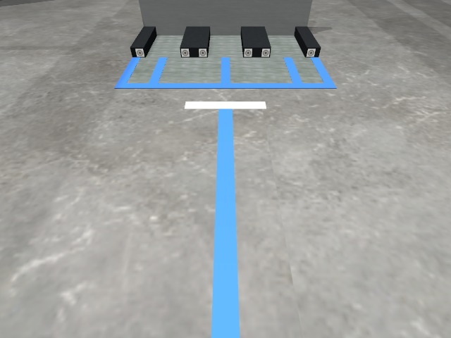
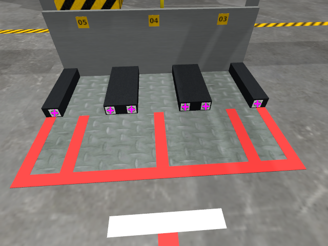
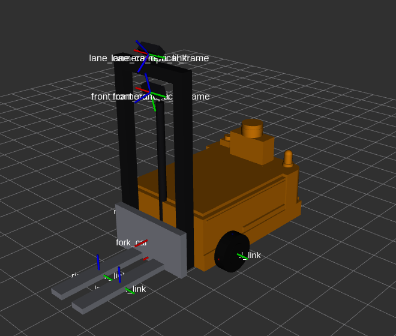
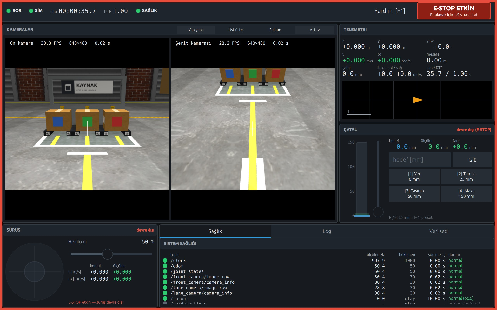
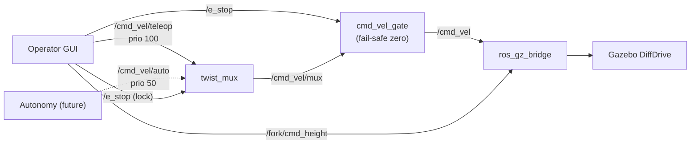

# Vision-Guided Forklift

[](https://docs.ros.org/en/jazzy/)
[](https://gazebosim.org/docs/harmonic)
[](https://doc.qt.io/qt-6/)
[](https://en.cppreference.com/w/cpp/17)
[](https://releases.ubuntu.com/24.04/)

A small differential-drive forklift robot in simulation, built as the platform
for a computer-vision learning project. The workspace contains a
simulator-agnostic robot description, a Gazebo Harmonic test bench with
automated acceptance tests, parametric load stations with alignment targets, a
factory world with a marked AMR cell, a fail-safe velocity command chain and a
Qt 6 / QML operator GUI.

<p align="center">
  
  <br><em>Factory world: the AMR cell with the source station (red/green/blue sealed parcels), three destination stations and guide lanes.</em>
</p>

## Highlights

- **Modular robot description**: xacro components (chassis, drive wheels,
  caster, mast, prismatic fork, two cameras) and a visual-only industrial body.
  Every dimension, mass and limit lives in one YAML file. Gazebo-specific
  content is isolated in one file.
- **Physics-validated simulation**: 14 automated acceptance tests (T1–T14)
  cover the model, drive accuracy, fork control, parcel carrying, braking and
  cameras. All 14 pass in the final run.
- **Load stations**: data-driven multi-bay stations (xacro → SDF, generated
  from two YAML files). Each bay has two ledges with a fork channel between
  them, a bay lane in the station colour that leads the lane camera to the
  channel, and two bullseye alignment targets beside the channel for the final
  lateral and yaw alignment. The station is identified by its colour-coded
  sign (no fiducial IDs, D-56). Acceptance tests cover geometry, stability, the
  drop/pick tolerance and performance.
- **Factory world**: a real-scale hall generated from one YAML file, with a
  hazard-taped cell, guide lanes in each station's colour (with ground truth
  for lane detection),
  industrial station and parcel materials, and lighting calibrated against the
  test world so the vision thresholds carry over.
- **Fail-safe command chain**: `twist_mux` arbitration plus a `cmd_vel_gate`
  node that commands zero velocity on e-stop or when the operator goes silent.
  Gazebo's DiffDrive would otherwise keep the last command forever.
- **Operator GUI**: C++17 core in a ports-and-adapters design (no ROS in the
  core), with ROS and mock adapters and a QML view. It runs without a ROS graph
  in mock mode.

## Factory world

`world:=factory` puts the stations and the robot in a real-scale brick hall
(Open Robotics' Depot) with a marked AMR cell: hazard-taped boundary, guide
lanes with stop bars, a walkway, shelving and pallet loads. The world is
generated at build time from `config/factory.yaml`. Lighting is calibrated so
the front camera sees the parcel seals within ±6 % of `station_test`
(DECISIONS D-53).

<table>
  <tr>
    <td align="center" width="50%"><br><sub>Gazebo GUI on launch: the hall, the cell and the roll-up doors</sub></td>
    <td align="center" width="50%"><br><sub>The cell from the door side: pillar guards, safety signs, walkway</sub></td>
  </tr>
</table>

## Load stations

<table>
  <tr>
    <td align="center" width="50%"><br><sub>Empty station: colour-coded sign, bay lanes in the station colour and two bullseye alignment targets beside each fork channel (D-55, D-56)</sub></td>
    <td align="center" width="50%"><br><sub>Source station: neutral sign, yellow bay lanes, kraft parcels with their seals</sub></td>
  </tr>
  <tr>
    <td align="center" width="50%"><br><sub>Lane camera 1 m from a station: the coloured floor lane, the bay lanes and the targets</sub></td>
    <td align="center" width="50%"><br><sub>Lane-camera view at 0.6 m (−2 cm, −4°): the six targets found (dark-mass centroid); channel axis ≤ 0.22 mm and yaw ≤ 0.2° up to 1.2 m with added noise</sub></td>
  </tr>
</table>

| Check | Result |
|---|---|
| Drop tolerance (fork 0.12 m in a 0.17 m channel) | Clean drop up to ±2.5 cm lateral offset; at ±3 cm the fork lands on a ledge |
| Pick | 0.5 m reverse with the parcel: 0.00 mm relative slip |
| Alignment targets (lane camera, 0.45–1.2 m, noise σ ≤ 0.02) | Channel axis ≤ 0.22 mm, yaw ≤ 0.20° (bullseye, centroid; REPORT_STATIONS §13) |

How the robot is meant to find a bay: the sign colour tells the station
(front camera), the coloured floor lane leads there, the bay lane aligns the
robot with the channel axis, and the bullseye pair gives the last
millimetres and the stop distance. Parcel presence and seal colour come from
object detection. `config/markers.yaml` is ground truth for evaluation only.

## Robot model

<table>
  <tr>
    <td align="center" width="50%"><br><sub>Gazebo: counterweight, LiDAR tower, beacon, e-stop and decals (visual only, D-54)</sub></td>
    <td align="center" width="50%"><br><sub>Mast, fork carriage, lift cylinder and the two camera mounts</sub></td>
  </tr>
  <tr>
    <td align="center" width="50%"><br><sub>RViz with the TF frames (REP-105 tree). RViz draws each link in one colour (D-54)</sub></td>
    <td align="center" width="50%"><br><sub>Equivalent inertia boxes, used to check the mass model</sub></td>
  </tr>
</table>

## Onboard cameras

Two 640×480 / 30 Hz cameras; every image `frame_id` is an optical frame.

<table>
  <tr>
    <td align="center" width="50%"><br><sub><code>front_camera</code> at the spawn pose: the source station 1.5 m ahead</sub></td>
    <td align="center" width="50%"><br><sub><code>lane_camera</code>: mast-top mount, tilted 45° down at the guide lane</sub></td>
  </tr>
</table>

## Operator GUI

<table>
  <tr>
    <td align="center" colspan="2"><br><sub>Operator GUI connected to the factory simulation: both cameras, telemetry, fork control and topic health. It starts with the e-stop latched; releasing it needs a 1.5 s press.</sub></td>
  </tr>
  <tr>
    <td align="center" width="50%"><br><sub>Detection overlay (<code>vision_msgs/Detection2DArray</code>). The boxes are synthetic test detections from integration test I9, not a real detector.</sub></td>
    <td align="center" width="50%"><br><sub>Keyboard shortcuts (F1), shown in mock mode: synthetic cameras and robot, no ROS graph</sub></td>
  </tr>
</table>

The GUI's UI language is Turkish.

## Command chain



`twist_mux` only stops forwarding on a lock or timeout; it never publishes a
zero. `cmd_vel_gate` turns "nothing is allowed" into "zero commanded". See
[ARCHITECTURE.md §7.6](ARCHITECTURE.md) and [DECISIONS.md](DECISIONS.md) D-24.

## Measured results

| Capability | Result |
|---|---|
| Differential drive | Odometry vs. ground truth: 0.00 % on a straight run, 0.01° after a 360° turn |
| Fork lift | 0–0.15 m at 0.05 m/s; overshoot 0.63 mm |
| Parcel carrying (0.5 kg) | About 2.5 m with two 90° turns and a hard brake: 0.18 mm relative slip |
| Hard brake under load (from 0.3 m/s) | No tip-over; the caster stays on the floor (max lift 0.000 mm) |
| E-stop from the GUI | `/cmd_vel` zero 17.9 ms after the key press |
| GUI killed (`kill -9`) while driving | Robot stopped in 0.38 s |
| GUI camera display | 29.2 / 28.4 FPS average (front / lane) |
| GUI performance cost | 18.7 % of one CPU core; simulation real-time factor unchanged (1.00) |
| Factory world cost | RTF 1.00 and 30.3 Hz cameras as in `station_test`; +1.46 GB GPU memory with the Gazebo GUI |

Full results: [docs/test_results.md](docs/test_results.md) (simulation T1–T14),
[docs/station_test_results.md](docs/station_test_results.md) (stations S1–S8),
[docs/gui_test_results.md](docs/gui_test_results.md) (GUI I1–I12) and
[docs/logs/factory/perf_results.md](docs/logs/factory/perf_results.md) (world
performance). Raw logs are in `docs/logs/`.

<details>
<summary><strong>Test plots</strong></summary>
<br>

| T7 — fork step response (unloaded) | T8 — parcel slip while carrying |
|---|---|
|  |  |

| T10 — hard brake under load | T3 — idle stability after spawn |
|---|---|
|  |  |

Plot labels are in Turkish.

</details>

## Packages

| Package | Purpose |
|---|---|
| [`forklift_description`](src/forklift_description) | Modular xacro model; all parameters in `config/forklift_params.yaml`. `display.launch.py` for RViz. |
| [`forklift_gazebo`](src/forklift_gazebo) | Test worlds (`lift_test`, `station_test`) and the generated `factory` world, sealed test parcel, parametric station and parcel xacros, alignment-target and sign textures, ROS ↔ Gazebo bridges, `sim.launch.py` / `station_sim.launch.py`, the T1–T14 and S-series acceptance tests and a performance probe. |
| [`forklift_safety`](src/forklift_safety) | Command chain: `twist_mux` config and the `cmd_vel_gate` node (unit-tested). Started by `sim.launch.py`. |
| [`forklift_gui`](src/forklift_gui) | Operator GUI: Qt-only core, ROS and mock adapters, QML view, QtTest unit tests and an end-to-end test. |
| [`forklift_bringup`](src/forklift_bringup) | One launch file for simulation + RViz + GUI (`world:=lift_test\|station_test\|factory`). |

## Requirements

Ubuntu 24.04, ROS 2 Jazzy, Gazebo Sim 8 (Harmonic, ROS vendor packages) and
the system Qt 6.4.2. Exact versions and the apt install list for Qt,
`twist_mux` and the test tools are in [ARCHITECTURE.md §7.1](ARCHITECTURE.md).

## Build

```bash
mkdir -p ~/cv_forklift_ws && cd ~/cv_forklift_ws
git clone git@github.com:muhammet-alaybey-cilesiz/vision-guided-forklift.git .
rosdep install --from-paths src --ignore-src -y
colcon build --symlink-install
source install/setup.bash
```

## Run

```bash
# Simulation + RViz + command chain + operator GUI
ros2 launch forklift_bringup bringup.launch.py world:=factory        # factory hall with stations
ros2 launch forklift_bringup bringup.launch.py world:=station_test   # plain station test world
ros2 launch forklift_bringup bringup.launch.py                       # lift_test (default)

# Station world only (stations and parcels from config/stations.yaml)
ros2 launch forklift_gazebo station_sim.launch.py
ros2 launch forklift_gazebo station_sim.launch.py station_world:=factory

# Simulation only (also starts the command chain)
ros2 launch forklift_gazebo sim.launch.py

# GUI without ROS: mock robot, synthetic cameras and logs
ros2 launch forklift_gui gui.launch.py mock:=true

# Robot model with joint sliders in RViz
ros2 launch forklift_description display.launch.py
```

GUI controls: <kbd>W</kbd><kbd>A</kbd><kbd>S</kbd><kbd>D</kbd> drive (hold),
<kbd>R</kbd>/<kbd>F</kbd> fork ±5 mm, <kbd>1</kbd>–<kbd>4</kbd> fork presets,
<kbd>Space</kbd> e-stop, <kbd>C</kbd> save a dataset frame pair,
<kbd>F1</kbd> help.

## Tests

```bash
colcon test && colcon test-result --verbose          # unit tests + linters
ros2 run forklift_gazebo acceptance_test.py           # simulation T1–T14 (~5 min)
ros2 run forklift_gazebo station_acceptance.py        # stations S1–S8 (~10 min)
ros2 run forklift_gazebo measure_sim_performance.py   # RTF, camera rate, CPU/GPU per world (~10 min)
ros2 run forklift_gui integration_test.py             # GUI end-to-end I1–I12
```

## Documentation

- [ARCHITECTURE.md](ARCHITECTURE.md) — frames, ROS ↔ Gazebo interface, launch graph, GUI layers and thread model
- [DECISIONS.md](DECISIONS.md) — design decision log (D-01 … D-56)
- [REPORT.md](REPORT.md) — simulation phase report (Turkish)
- [REPORT_STATIONS.md](REPORT_STATIONS.md) — load station report (Turkish)
- [REPORT_FACTORY.md](REPORT_FACTORY.md) — factory world and robot appearance report (Turkish)

## Third-party assets

The factory world downloads these models from [Gazebo Fuel](https://app.gazebosim.org)
on its first run (pinned versions, cached in `~/.gz/fuel`):

| Asset | Author / source | License |
|---|---|---|
| `Depot` v6 (hall) | Rafi Abdullah, Louise Poubel (Open Robotics) | [CC-BY 4.0](http://creativecommons.org/licenses/by/4.0/) |
| `aws_robomaker_warehouse_*` v4 (ShelfD/E, ClutteringA/C/D, PalletJackB, TrashCanC) | AWS RoboMaker Small Warehouse World, published on Fuel by Open Robotics | [CC-BY 4.0](http://creativecommons.org/licenses/by/4.0/) |
| `Fire Extinguisher` v5 | Cole Biesemeyer (Open Robotics) | [CC0 1.0](https://creativecommons.org/publicdomain/zero/1.0/) |

The photo textures in `src/forklift_gazebo/models/factory_materials` are from
[ambientCG](https://ambientcg.com) (CC0 1.0); see its
[README](src/forklift_gazebo/models/factory_materials/README.md). Signs, labels
and decals are generated at build time by this repository's scripts.

## Versions

`main` always holds the latest version. Every earlier version is kept as a tag
and as a read-only `release/*` branch, so it can be browsed on GitHub without
downloading anything (switch the branch selector to `release/...`):

| Version | Branch / tag | Contents |
|---|---|---|
| v0.1.0 | [`release/v0.1.0`](../../tree/release/v0.1.0) | Robot description, simulation test bench (T1–T14), command chain, operator GUI |
| v0.2.0 | [`release/v0.2.0`](../../tree/release/v0.2.0) | + Load stations with ArUco markers, `station_test` world (S1–S8) — markers later removed (D-56) |
| v0.3.0 | [`release/v0.3.0`](../../tree/release/v0.3.0) | + Factory world, industrial station/parcel look, robot body (D-53, D-54) — same as `main` today |

## Roadmap

Perception (parcel and seal detection on the front camera), lane following on
the lane camera, and autonomous pick-and-place through the `/cmd_vel/auto`
input. None of these are implemented yet.
