# Vision-Guided Forklift

[](https://docs.ros.org/en/jazzy/)
[](https://gazebosim.org/docs/harmonic)
[](https://doc.qt.io/qt-6/)
[](https://en.cppreference.com/w/cpp/17)
[](https://releases.ubuntu.com/24.04/)

A small differential-drive forklift robot in simulation, built as the platform
for a computer-vision learning project. The workspace contains a
simulator-agnostic robot description, a Gazebo Harmonic test bench with
automated acceptance tests, parametric load stations with ArUco markers, a
fail-safe velocity command chain and a Qt 6 / QML operator GUI.

<p align="center">
  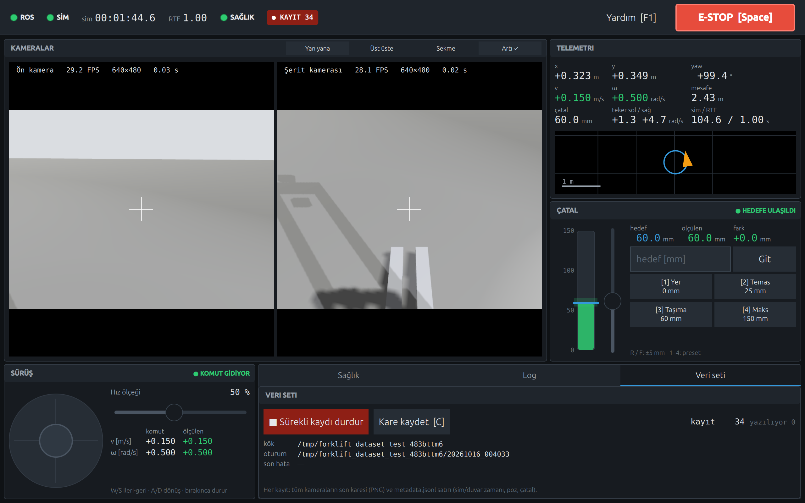
  <br><em>Operator GUI connected to the running simulation: both cameras, telemetry, fork control and topic health.</em>
</p>

## Highlights

- **Modular robot description**: xacro components (chassis, drive wheels,
  caster, mast, prismatic fork, two cameras). Every dimension, mass and limit
  lives in one YAML file. Gazebo-specific content is isolated in one file.
- **Physics-validated simulation**: 14 automated acceptance tests (T1–T14)
  cover the model, drive accuracy, fork control, parcel carrying, braking and
  cameras. All 14 pass in the final run.
- **Fail-safe command chain**: `twist_mux` arbitration plus a `cmd_vel_gate`
  node that commands zero velocity on e-stop or when the operator goes silent.
  Gazebo's DiffDrive would otherwise keep the last command forever.
- **Operator GUI**: C++17 core in a ports-and-adapters design (no ROS in the
  core), with ROS and mock adapters and a QML view. It runs without a ROS graph
  in mock mode.
- **Load stations**: data-driven multi-bay stations (xacro → SDF, generated
  from two YAML files). Each bay has two ledges with a fork channel between
  them and two ArUco markers: an upper one that a parcel hides, for approach
  and occupancy, and a lower one seen through the channel, for fine alignment.
  Acceptance tests S1–S8 cover geometry, stability, marker detection, the
  drop/pick tolerance and performance.

## Simulation

<table>
  <tr>
    <td align="center" width="33%">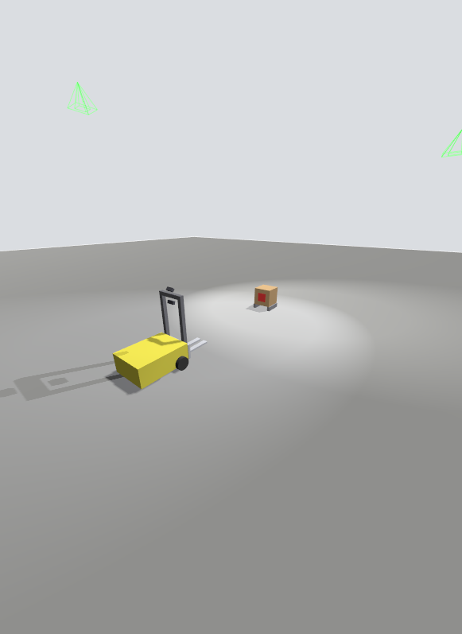<br><sub>Test world: robot and the sealed test parcel</sub></td>
    <td align="center" width="33%">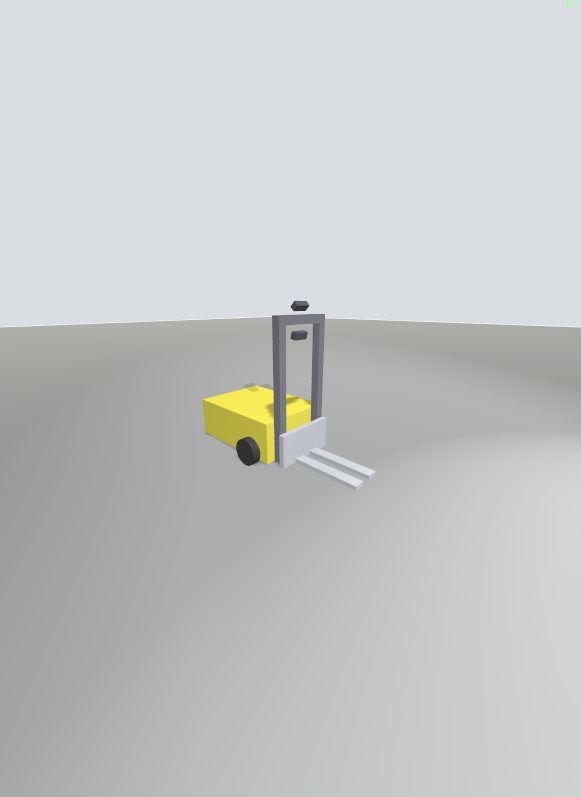<br><sub>Mast, fork carriage and the two camera mounts</sub></td>
    <td align="center" width="33%">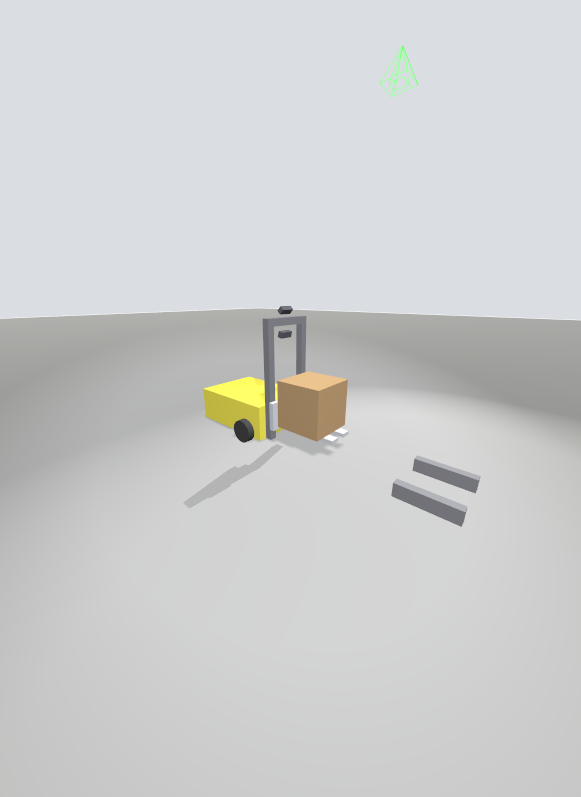<br><sub>Carrying the 0.5 kg parcel off its rails</sub></td>
  </tr>
</table>

## Load stations

<table>
  <tr>
    <td align="center" width="50%"><br><sub><code>station_test</code>: full source station (R/G/B) and three empty destination stations</sub></td>
    <td align="center" width="50%"><br><sub>Front camera at 0.6 m from an empty station: upper (k) and lower (k + 25) markers detected</sub></td>
  </tr>
</table>

| Check | Result |
|---|---|
| Drop tolerance (fork 0.12 m in a 0.17 m channel) | Clean drop up to ±2.5 cm lateral offset; at ±3 cm the fork lands on a ledge |
| Pick | 0.5 m reverse with the parcel: 0.00 mm relative slip |
| Upper marker (front camera, 0.6–1.5 m, ±15°) | Detected on empty bays, hidden by the parcel on full bays |
| Lower marker (test camera, 0.2–0.8 m) | Detected with and without a parcel; lateral error ≤ 1.6 mm at 0.5 m; yaw not observable at this marker size (see REPORT_STATIONS) |

## Robot model

<table>
  <tr>
    <td align="center" width="50%">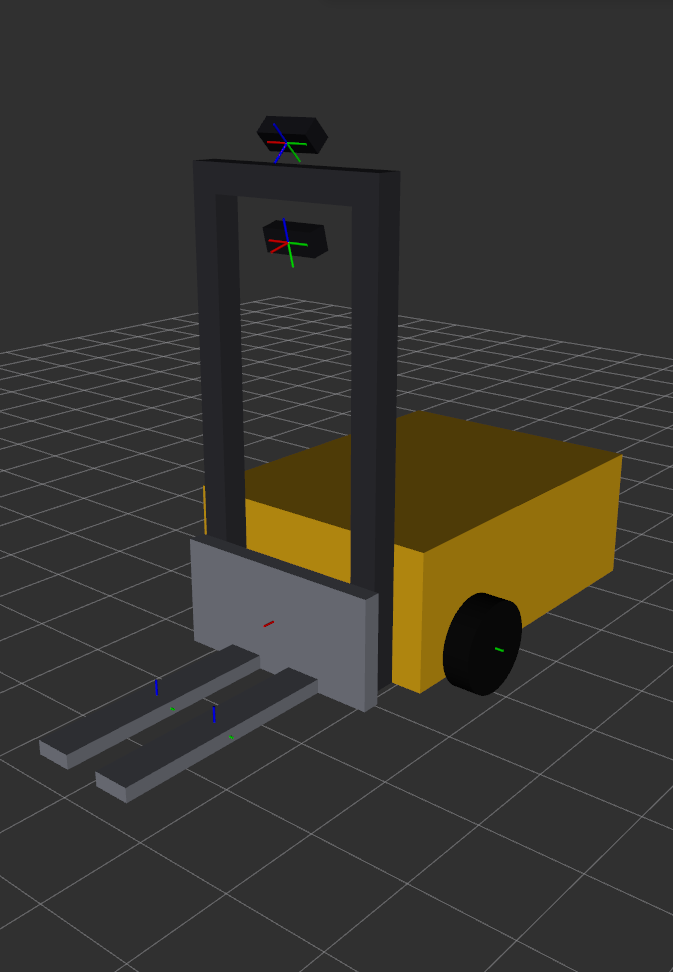<br><sub>Robot model and TF frames in RViz (REP-105 tree)</sub></td>
    <td align="center" width="50%">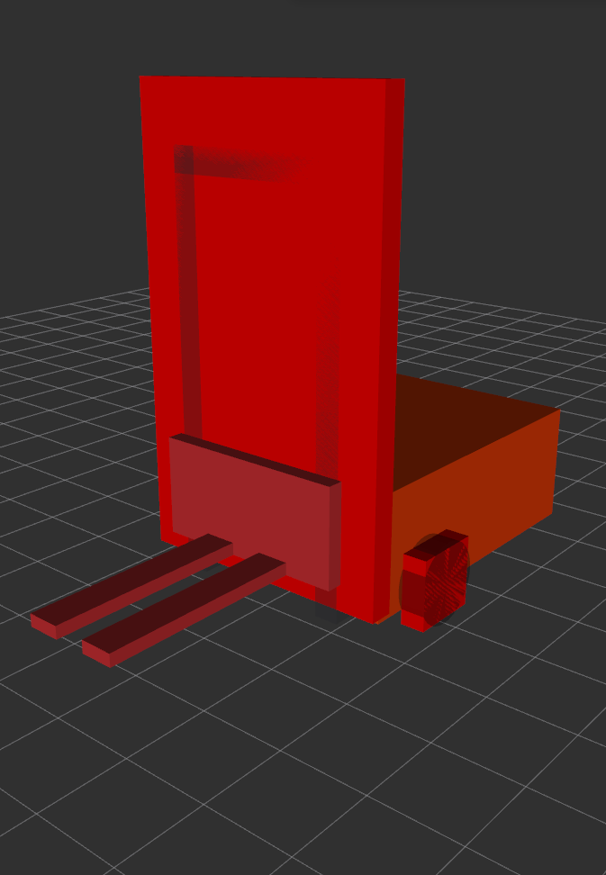<br><sub>Equivalent inertia boxes, used to check the mass model</sub></td>
  </tr>
</table>

## Onboard cameras

Two 640×480 / 30 Hz cameras; every image `frame_id` is an optical frame.

<table>
  <tr>
    <td align="center" width="50%">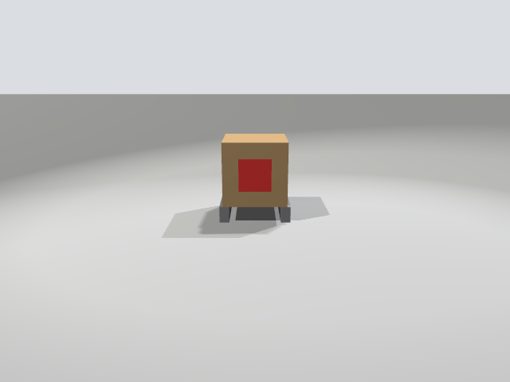<br><sub><code>front_camera</code>: parcel 1.5 m ahead</sub></td>
    <td align="center" width="50%">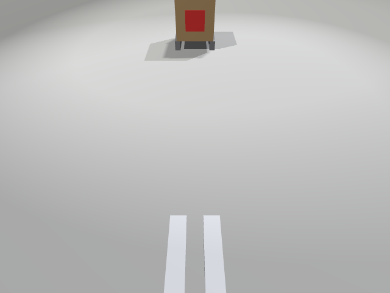<br><sub><code>lane_camera</code>: mast-top mount, tilted 45° down at the floor ahead</sub></td>
  </tr>
</table>

## Operator GUI

<table>
  <tr>
    <td align="center" width="50%">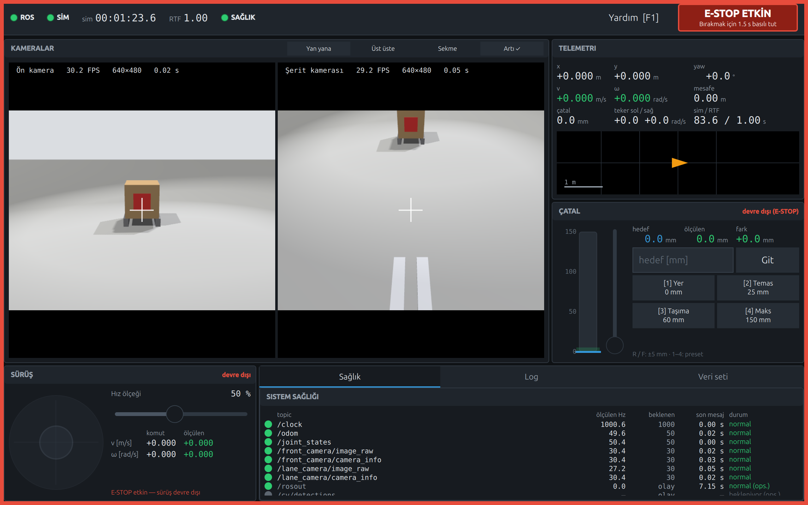<br><sub>E-stop latched: drive and fork are disabled. Releasing it needs a 1.5 s press.</sub></td>
    <td align="center" width="50%">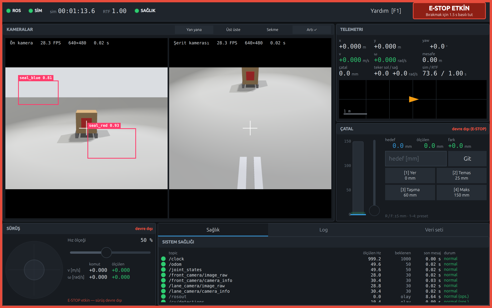<br><sub>Detection overlay (<code>vision_msgs/Detection2DArray</code>). The boxes are synthetic test detections from integration test I9, not a real detector.</sub></td>
  </tr>
  <tr>
    <td align="center" colspan="2">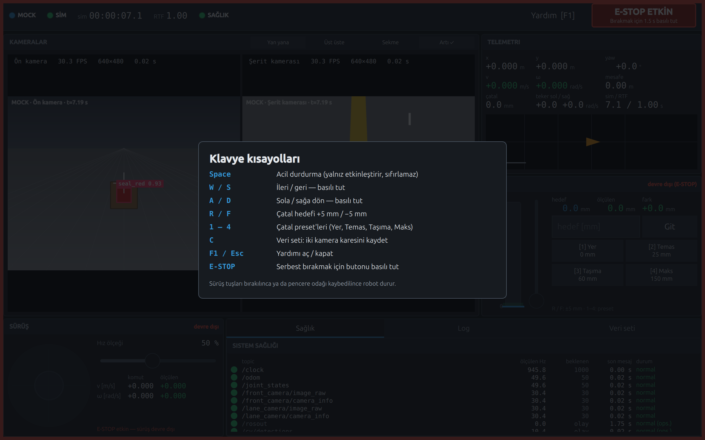<br><sub>Keyboard shortcuts (F1), shown in mock mode: synthetic cameras and robot, no ROS graph</sub></td>
  </tr>
</table>

The GUI's UI language is Turkish.

## Command chain

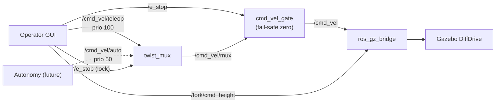

`twist_mux` only stops forwarding on a lock or timeout; it never publishes a
zero. `cmd_vel_gate` turns "nothing is allowed" into "zero commanded". See
[ARCHITECTURE.md §7.6](ARCHITECTURE.md) and [DECISIONS.md](DECISIONS.md) D-24.

## Measured results

| Capability | Result |
|---|---|
| Differential drive | Odometry vs. ground truth: 0.00 % on a straight run, 0.01° after a 360° turn |
| Fork lift | 0–0.15 m at 0.05 m/s; overshoot 0.63 mm |
| Parcel carrying (0.5 kg) | About 2.5 m with two 90° turns and a hard brake: 0.18 mm relative slip |
| Hard brake under load (from 0.3 m/s) | No tip-over; the caster stays on the floor (max lift 0.000 mm) |
| E-stop from the GUI | `/cmd_vel` zero 17.9 ms after the key press |
| GUI killed (`kill -9`) while driving | Robot stopped in 0.38 s |
| GUI camera display | 29.2 / 28.4 FPS average (front / lane) |
| GUI performance cost | 18.7 % of one CPU core; simulation real-time factor unchanged (1.00) |

Full results: [docs/test_results.md](docs/test_results.md) (simulation T1–T14)
and [docs/gui_test_results.md](docs/gui_test_results.md) (GUI I1–I12). Raw logs
are in `docs/logs/`.

<details>
<summary><strong>Test plots</strong></summary>
<br>

| T7 — fork step response (unloaded) | T8 — parcel slip while carrying |
|---|---|
| 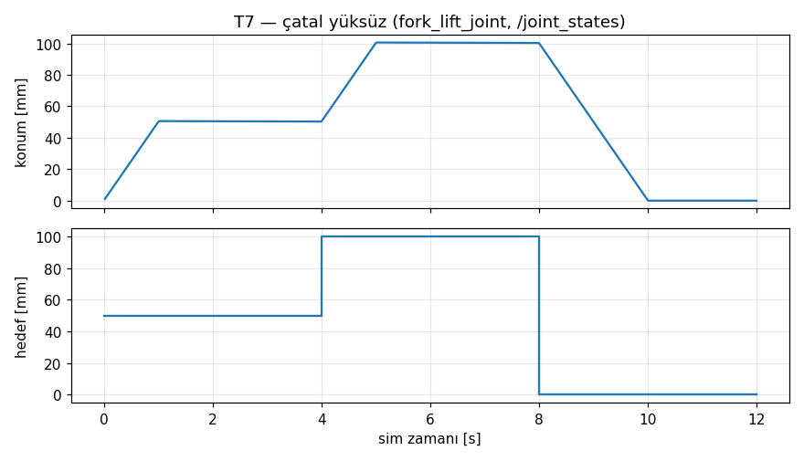 | 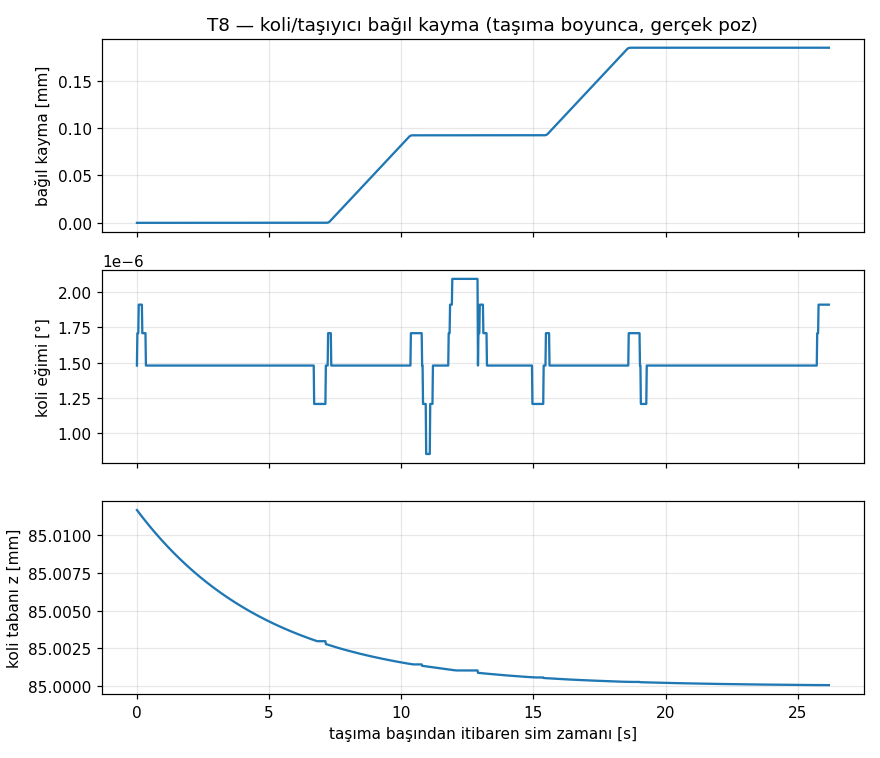 |

| T10 — hard brake under load | T3 — idle stability after spawn |
|---|---|
| 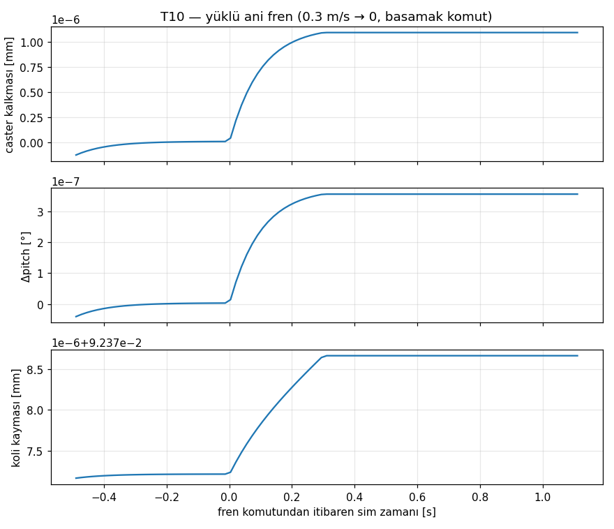 | 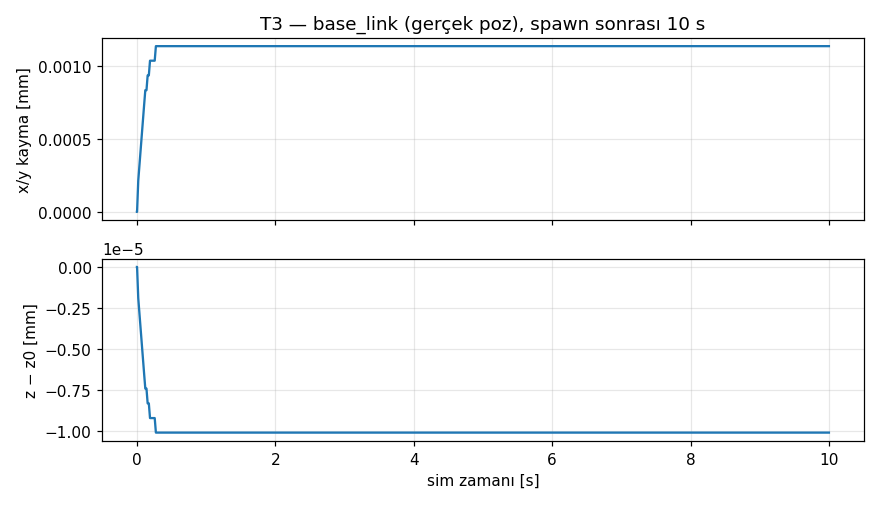 |

Plot labels are in Turkish.

</details>

## Packages

| Package | Purpose |
|---|---|
| [`forklift_description`](src/forklift_description) | Modular xacro model; all parameters in `config/forklift_params.yaml`. `display.launch.py` for RViz. |
| [`forklift_gazebo`](src/forklift_gazebo) | Test worlds (`lift_test`, `station_test`), sealed test parcel, parametric station and parcel xacros, ArUco textures, ROS ↔ Gazebo bridges, `sim.launch.py` / `station_sim.launch.py`, and the T1–T14 and S1–S8 acceptance tests. |
| [`forklift_safety`](src/forklift_safety) | Command chain: `twist_mux` config and the `cmd_vel_gate` node (unit-tested). Started by `sim.launch.py`. |
| [`forklift_gui`](src/forklift_gui) | Operator GUI: Qt-only core, ROS and mock adapters, QML view, QtTest unit tests and an end-to-end test. |
| [`forklift_bringup`](src/forklift_bringup) | One launch file for simulation + RViz + GUI (`world:=lift_test\|station_test`). |

## Requirements

Ubuntu 24.04, ROS 2 Jazzy, Gazebo Sim 8 (Harmonic, ROS vendor packages) and
the system Qt 6.4.2. Exact versions and the apt install list for Qt,
`twist_mux` and the test tools are in [ARCHITECTURE.md §7.1](ARCHITECTURE.md).

## Build

```bash
mkdir -p ~/cv_forklift_ws && cd ~/cv_forklift_ws
git clone git@github.com:muhammet-alaybey-cilesiz/vision-guided-forklift.git .
rosdep install --from-paths src --ignore-src -y
colcon build --symlink-install
source install/setup.bash
```

## Run

```bash
# Simulation + RViz + command chain + operator GUI
ros2 launch forklift_bringup bringup.launch.py
ros2 launch forklift_bringup bringup.launch.py world:=station_test   # load stations

# Station world only (stations and parcels from config/stations.yaml)
ros2 launch forklift_gazebo station_sim.launch.py

# Simulation only (also starts the command chain)
ros2 launch forklift_gazebo sim.launch.py

# GUI without ROS: mock robot, synthetic cameras and logs
ros2 launch forklift_gui gui.launch.py mock:=true

# Robot model with joint sliders in RViz
ros2 launch forklift_description display.launch.py
```

GUI controls: <kbd>W</kbd><kbd>A</kbd><kbd>S</kbd><kbd>D</kbd> drive (hold),
<kbd>R</kbd>/<kbd>F</kbd> fork ±5 mm, <kbd>1</kbd>–<kbd>4</kbd> fork presets,
<kbd>Space</kbd> e-stop, <kbd>C</kbd> save a dataset frame pair,
<kbd>F1</kbd> help.

## Tests

```bash
colcon test && colcon test-result --verbose          # unit tests + linters
ros2 run forklift_gazebo acceptance_test.py           # simulation T1–T14 (~5 min)
ros2 run forklift_gazebo station_acceptance.py        # stations S1–S8 (~10 min)
ros2 run forklift_gui integration_test.py             # GUI end-to-end I1–I12
```

## Documentation

- [ARCHITECTURE.md](ARCHITECTURE.md) — frames, ROS ↔ Gazebo interface, launch graph, GUI layers and thread model
- [DECISIONS.md](DECISIONS.md) — design decision log (D-01 … D-51)
- [REPORT.md](REPORT.md) — simulation phase report (Turkish)
- [REPORT_STATIONS.md](REPORT_STATIONS.md) — load station report (Turkish)

## Roadmap

Perception (parcel and seal detection on the front camera), lane following on
the lane camera, and autonomous pick-and-place through the `/cmd_vel/auto`
input. None of these are implemented yet.
