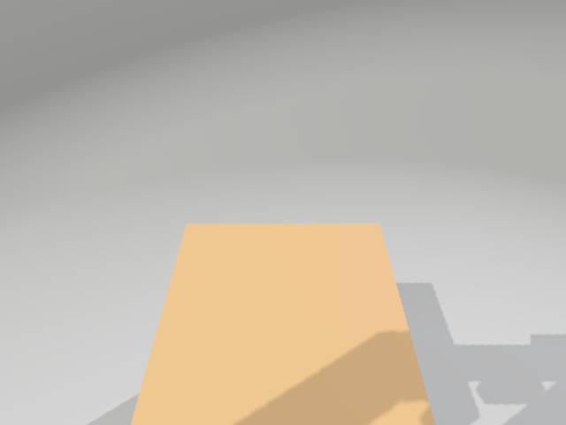
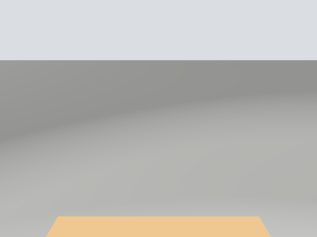

# CV Forklift — Proje Raporu

**Tarih:** 2026-10-14
**Ortam:**
- Ubuntu 24.04.5, ROS 2 Jazzy, Gazebo Sim 8.15.0 (Harmonic; ROS vendor paketleri)
- sdformat 14.9.0, gz-sensors 8.2.2, gz-physics 7.8.0 (DART 6.13.2), ros_gz 1.0.24
- NVIDIA RTX 5070 Laptop GPU

**Sonuçların kaynağı:** `acceptance_test.py` ile tek seferde yapılan son tam koşu (14/14 GEÇTİ, çıkış kodu 0). Ham çıktı [docs/test_results.md](docs/test_results.md) dosyasında.

---

## 1. Özet

İki `ament_cmake` paketi geliştirildi.
- `forklift_description`: Simülatörden bağımsız, modüler bir xacro robot tanımı. Tüm sayılar tek bir YAML dosyasında.
- `forklift_gazebo`: Gazebo Harmonic test düzeneği. Dünya, mühürlü test kolisi, ROS↔GZ köprüleri, launch dosyası ve T1–T14'ü kendi simülasyon oturumlarını açarak koşan bir kabul testi içeriyor.

Robotun ölçülen yetenekleri:

| Yetenek | Ölçülen sonuç |
|---|---|
| Diferansiyel sürüş | Düz sürüşte odometri ile gerçek poz arasındaki fark %0.00; 360° dönüşte fark 0.01° |
| Çatal kaldırma | 0–0.15 m, 0.05 m/s; aşım 0.63 mm |
| Koli taşıma (0.5 kg) | Yaklaşık 2.5 m'lik yol, iki 90° dönüş ve bir ani fren boyunca bağıl kayma 0.18 mm |
| Yüklü ani fren (0.3 m/s'den) | Arka tekerlek kalkmıyor |
| Kameralar | İki adet 640×480 / 30 Hz; `frame_id` optical frame |

Spesifikasyonun yazıldığı haliyle uygulanamayan üç noktası kanıtlarla düzeltildi:
- T8 senaryosu (D-16)
- T10'un T8 içinde koşması (D-19)
- Tekerlek çarpışma şekli (D-20)

Çatal kontrolcüsü, DART'ın limitteki eklemde servo komutunu atlaması yüzünden PID moduna alındı (D-10).

## 2. Paket ağacı

```
~/cv_forklift_ws/
├── ARCHITECTURE.md                    paket yapısı, frame ağacı, topic tablosu (İngilizce)
├── DECISIONS.md                       21 tasarım kararı, kaynak kod satırı referanslarıyla (İngilizce)
├── REPORT.md                          bu rapor
├── docs/
│   ├── frames_display.pdf / .gv       TF ağacı, görüntüleme modu (kök base_footprint)
│   ├── frames_sim.pdf / .gv           TF ağacı, simülasyon (kök odom)
│   ├── test_results.md / .json        son kabul testi koşusunun çıktısı
│   ├── images/                        Gazebo/RViz görüntüleri, T12 kareleri, test grafikleri
│   └── logs/                          T1/T2 günlükleri, üretilen URDF/SDF, sim oturum günlükleri
└── src/
    ├── forklift_description/
    │   ├── config/forklift_params.yaml        tüm ölçü, kütle, limit, sürtünme, kontrol ve sensör parametreleri
    │   ├── urdf/forklift.urdf.xacro           üst seviye montaj: argümanlar, YAML yükleme, makro çağrıları
    │   ├── urdf/common/inertial_macros.xacro  kutu / silindir / küre ve bileşik kutu atalet makroları
    │   ├── urdf/common/materials.xacro        görsel renkler
    │   ├── urdf/components/chassis.xacro      base_footprint / base_link çerçeveleri + şasi
    │   ├── urdf/components/drive_wheel.xacro  tahrik tekerleği makrosu (side: left/right)
    │   ├── urdf/components/caster.xacro       sarhoş teker (zemine teğet, z türetilir)
    │   ├── urdf/components/mast.xacro         direk: iki dikme + üst çubuk, bileşik atalet
    │   ├── urdf/components/fork_carriage.xacro taşıyıcı, prismatic fork_lift_joint, iki çatal
    │   ├── urdf/components/camera.xacro       kamera makrosu (link + optical frame) ve direğe montaj
    │   ├── urdf/gazebo/forklift.gazebo.xacro  YALNIZ sim: sürtünme, kamera sensörleri, DiffDrive / JPC / JSP
    │   ├── launch/display.launch.py           robot_state_publisher + joint_state_publisher(_gui) + RViz
    │   ├── rviz/forklift.rviz                 RViz düzeni (robot modeli, TF, kapalı görüntü panelleri)
    │   └── CMakeLists.txt, package.xml, README.md
    └── forklift_gazebo/
        ├── worlds/lift_test.sdf               test dünyası: zemin, ray çifti, koli, 3 ışık, 4 sistem
        ├── models/test_parcel/                kırmızı mühürlü test kolisi (model.sdf, model.config)
        ├── config/ros_gz_bridge.yaml          görüntü dışındaki tüm köprüler
        ├── launch/sim.launch.py               gz sim + spawn + robot_state_publisher + köprüler (+RViz)
        ├── scripts/acceptance_test.py         T1–T14 otomatik kabul testleri
        └── CMakeLists.txt, package.xml, README.md
```

## 3. Frame ağacı

Ağaç REP-105'e uyuyor. view_frames çıktıları: [docs/frames_sim.pdf](docs/frames_sim.pdf) (simülasyon) ve [docs/frames_display.pdf](docs/frames_display.pdf) (görüntüleme).

```
odom                                      DiffDrive TF (yalnız sim)
└── base_footprint                        kök link, atalet yok (KDL uyarısı yok), z = 0
    └── base_link                         fixed, (0, 0, 0.05): tahrik aksı merkezi
        ├── chassis_link                  fixed, (-0.12, 0, 0.045)
        ├── left_wheel_link               continuous, eksen +y, (0, +0.17, 0)
        ├── right_wheel_link              continuous, eksen +y, (0, -0.17, 0)
        ├── caster_link                   fixed, (-0.28, 0, -0.025)
        └── mast_link                     fixed, (0.095, 0, -0.03): direk tabanı merkezi
            ├── fork_carriage_link        prismatic +z [0, 0.15], (0.025, 0, 0.05)
            │   ├── left_fork_link        fixed, (0.135, +0.04, -0.0525)
            │   └── right_fork_link       fixed, (0.135, -0.04, -0.0525)
            ├── front_camera_link         fixed, (0.005, 0, 0.43), pitch 15°
            │   └── front_camera_optical_frame   rpy (-π/2, 0, -π/2)
            └── lane_camera_link          fixed, (0.005, 0, 0.52), pitch 45°
                └── lane_camera_optical_frame    rpy (-π/2, 0, -π/2)
```

**Gazebo görünümü.** sdformat sabit eklemleri birleştiriyor (lumping). Gazebo'daki modelde bu yüzden 4 link ve 3 eklem var:
- link'ler: `base_footprint` (9.3 kg; şasi, caster, direk ve kameralar), iki tekerlek, `fork_carriage_link` (0.9 kg; plaka ve çatallar)
- eklemler: iki tekerlek eklemi ve `fork_lift_joint`

T4'te TF'te 15 frame (14 link + `odom`) ve tek kök `odom` doğrulandı.

## 4. Ölçü ve kütle tablosu

"Uygulanan" sütunu, kurulu xacro'dan üretilen URDF üzerinde ileri kinematik ve görsel sınır kutusu hesabıyla ölçüldü. z değerleri "base_link'e göre" ya da "zemin" olarak belirtildi.

| Bileşen | Spesifikasyon | Uygulanan (üretilen URDF'ten ölçülen) | Durum |
|---|---|---|---|
| Şasi (chassis_link) | 0.40×0.30×0.15 m, 8.0 kg; merkez (-0.12, 0, +0.045); x ∈ [-0.32, 0.08], zemin z ∈ [0.02, 0.17] | 0.40×0.30×0.15 m, 8.0 kg; merkez (-0.120, +0.000, +0.045); x ∈ [-0.32, +0.08], zemin z ∈ [0.02, 0.17] | aynı |
| Tahrik tekerlekleri | silindir r 0.05, genişlik 0.03, 0.5 kg; (0, ±0.17, 0); continuous, eksen y; μ1 = μ2 = 1.0 | görsel ve atalet: silindir r 0.05, genişlik 0.03, 0.5 kg; (0.000, ±0.170, 0.000); continuous, eksen (0 1 0); SDF'te μ = μ2 = 1; **çarpışma: küre r 0.05** | **SAPMA (D-20)** |
| Teker açıklığı | 0.34 m | 0.340 m (DiffDrive `wheel_separation` = 0.34) | aynı |
| Sarhoş teker (caster_link) | küre r 0.025, 0.2 kg; (-0.28, 0, -0.025); fixed; μ = 0 | küre r 0.025, 0.2 kg; (-0.280, 0.000, -0.025); en alt nokta zemin z = 0.000; fixed; SDF'te yalnız bu çarpışmada μ = μ2 = 0 | aynı |
| Direk (mast_link) | dikme 0.03×0.03×0.50, y = ±0.10, x = 0.095, zemin z ∈ [0.02, 0.52]; üst çubuk 0.03×0.23×0.03; toplam 1.0 kg | dikme 0.03×0.03×0.50, y = ±0.100, x = 0.095, zemin z ∈ [0.02, 0.52]; üst çubuk 0.03×0.23×0.03, zemin z ∈ [0.49, 0.52]; toplam 1.0 kg (dikme 0.4065 ×2 + çubuk 0.1870) | yorum (D-05: çubuk yüksekliği verilmemiş) |
| Taşıyıcı (fork_carriage_link) | plaka 0.02×0.24×0.12, 0.5 kg; merkez x = 0.12; eklem 0'da zemin z ∈ [0.01, 0.13] | plaka 0.02×0.24×0.12, 0.5 kg; merkez x = 0.120; zemin z ∈ [0.01, 0.13] | aynı |
| Kaldırma eklemi | prismatic, parent mast_link, eksen +z; [0.0, 0.15] m; 0.05 m/s; 200 N; damping 5.0 | prismatic, parent mast_link, eksen (0 0 1); [0.00, 0.15] m; 0.05 m/s; 200 N; damping 5.0 | aynı |
| Çatallar | 0.25×0.04×0.015, 0.2 kg; x ∈ [0.13, 0.38], y = ±0.04; eklem 0'da zemin z ∈ [0.010, 0.025]; μ = 1.0 | 0.25×0.04×0.015, 0.2 kg; x ∈ [0.13, 0.38], y = ±0.040; zemin z ∈ [0.010, 0.025]; SDF'te μ = μ2 = 1 | aynı |
| front_camera | (0.10, zemin 0.45), pitch 15°, HFOV 1.047, 640×480 @ 30 Hz, Gauss σ 0.007, 0.05 kg | (0.100, 0.450), pitch 15.00°, HFOV 1.047, 640×480 rgb8 @ 30 Hz, σ 0.007, 0.05 kg; camera_info fx = 554.4 (HFOV'den beklenen 554.4) | aynı |
| lane_camera | (0.10, zemin 0.54), pitch 45°, HFOV 1.396, 640×480 @ 30 Hz, Gauss σ 0.007, 0.05 kg | (0.100, 0.540), pitch 45.00°, HFOV 1.396, 640×480 rgb8 @ 30 Hz, σ 0.007, 0.05 kg; fx = 381.5 (beklenen 381.5) | aynı |
| Toplam kütle | (yüksüz) | 11.20 kg | — |

## 5. Atalet tablosu

Her değer geometriden makroyla hesaplandı. Tensör link çerçevesinin eksenlerinde, birimi kg·m².

| Link | Kütle [kg] | Geometri (makro) | ixx | iyy | izz |
|---|---|---|---|---|---|
| chassis_link | 8.000 | kutu | 7.5000e-02 | 1.2167e-01 | 1.6667e-01 |
| left_wheel_link | 0.500 | silindir (eksen y) | 3.5000e-04 | 6.2500e-04 | 3.5000e-04 |
| right_wheel_link | 0.500 | silindir (eksen y) | 3.5000e-04 | 6.2500e-04 | 3.5000e-04 |
| caster_link | 0.200 | küre | 5.0000e-05 | 5.0000e-05 | 5.0000e-05 |
| mast_link | 1.000 | bileşik 3 kutu (paralel eksen) | 3.4363e-02 | 2.5422e-02 | 9.0904e-03 |
| fork_carriage_link | 0.500 | kutu | 3.0000e-03 | 6.1667e-04 | 2.4167e-03 |
| left_fork_link | 0.200 | kutu | 3.0417e-05 | 1.0454e-03 | 1.0683e-03 |
| right_fork_link | 0.200 | kutu | 3.0417e-05 | 1.0454e-03 | 1.0683e-03 |
| front_camera_link | 0.050 | kutu (0.02×0.06×0.025) | 1.7604e-05 | 4.2708e-06 | 1.6667e-05 |
| lane_camera_link | 0.050 | kutu (0.02×0.06×0.025) | 1.7604e-05 | 4.2708e-06 | 1.6667e-05 |

Direğin bileşik ataleti elle de kontrol edildi (ixx = 0.034362). RViz'in eşdeğer atalet kutuları da beklenen şekli veriyor: [docs/images/rviz_inertia.png](docs/images/rviz_inertia.png). Direğin kutusu 0.03 × 0.33 × 0.55 m çıkıyor; kütle ±0.10 m'deki dikmelerde toplandığı için gövdeden geniş.

Gazebo'nun yüklediği birleştirilmiş link'ler (`gz sdf -p`):

| SDF link | Kütle [kg] | Kütle merkezi (link çerçevesi) | ixx | iyy | izz |
|---|---|---|---|---|---|
| base_footprint | 9.300 | (-0.0980, 0, +0.1214) | 1.6850e-01 | 2.5754e-01 | 2.2718e-01 |
| left/right_wheel_link | 0.500 | (0, 0, 0) | 3.5000e-04 | 6.2500e-04 | 3.5000e-04 |
| fork_carriage_link | 0.900 | (+0.0600, 0, -0.0233) | 4.3133e-03 | 7.3700e-03 | 9.2433e-03 |

## 6. Ağırlık merkezi analizi (T13)

- **Hesap:** URDF'teki kütle dağılımı.
- **Sim:** gz'nin yüklediği birleştirilmiş SDF kütleleri, canlı link pozları ve kolinin gerçek pozuyla yerleştirildi.

x değeri base_link'e göre (aks = 0), z zemine göre.

| Durum | Kütle | COM x hesap / sim | COM z (zemin) | Ön marj (x = 0 aksı) | Arka marj (x = −0.28) | Destek üçgeni marjı | Caster'ın kalktığı fren ivmesi g·\|x\|/z |
|---|---|---|---|---|---|---|---|
| Yüksüz, çatal 0 | 11.20 kg | −0.0669 / −0.0669 m | 0.1090 m | **6.69 cm** | 21.31 cm | 6.69 cm | 6.0 m/s² |
| Yüklü, çatal 0.06 m, koli 0.5 kg, taşıyıcıya 1 cm boşluk | 11.70 kg | −0.0538 / −0.0539 m | 0.1169 m | **5.38 cm** | 22.61 cm | 5.38 cm | 4.5 m/s² |

- Kriter (≥ 3 cm marj) iki durumda da sağlanıyor. Bağlayıcı kenar, tahrik aksı çizgisi.
- Gerçek destek poligonu iki tekerlek ve caster'ın oluşturduğu üçgen. Bu üçgenin yan kenarları COM'a yaklaşık 11 cm uzaklıkta.
- DiffDrive yavaşlama sınırı 1.0 m/s², bu da devrilme eşiğine karşı 4.5–6 kat güvenlik payı bırakıyor.
- Sınırlayıcı olmasaydı μ = 1 ile frenleme yaklaşık 12–13.6 m/s²'ye çıkabilir, bu durumda caster kalkardı (D-09).

## 7. Topic ve arayüz tablosu

Ölçümler, son koşudan sonra açılan ayrı bir oturumda 10 s boyunca duvar saatiyle yapıldı. Tüm düğümler `use_sim_time: true` ile çalışıyor.

| Topic | Tip | Yön | Yapılandırılan | Ölçülen | Not |
|---|---|---|---|---|---|
| `/clock` | rosgraph_msgs/msg/Clock | GZ→ROS | her adım | 999.9 Hz | ros_gz_bridge |
| `/cmd_vel` | geometry_msgs/msg/Twist | ROS→GZ | kullanıcı | — | DiffDrive; ±0.5 m/s, ±1 m/s², ±1.5 rad/s, ±3 rad/s² |
| `/odom` | nav_msgs/msg/Odometry | GZ→ROS | 50 Hz | 50.0 Hz | frame `odom` → `base_footprint` |
| `/tf` | tf2_msgs/msg/TFMessage | GZ→ROS + ROS | 50 Hz (DiffDrive) | 66.6 Hz (toplam) | `odom→base_footprint` (DiffDrive) ve hareketli eklemler (robot_state_publisher) |
| `/tf_static` | tf2_msgs/msg/TFMessage | ROS | latched | — | robot_state_publisher (sabit eklemler) |
| `/joint_states` | sensor_msgs/msg/JointState | GZ→ROS | 50 Hz | 50.0 Hz | 3 eklem: tekerlekler ve fork_lift_joint |
| `/fork/cmd_height` | std_msgs/msg/Float64 [m] | ROS→GZ | kullanıcı | — | JointPositionController (PID), 0–0.15 m |
| `/front_camera/image_raw` | sensor_msgs/msg/Image | GZ→ROS | 30 Hz | 28.8 Hz* | ros_gz_image; ayrıca `/compressed`, `/theora`, `/zstd` |
| `/front_camera/camera_info` | sensor_msgs/msg/CameraInfo | GZ→ROS | 30 Hz | 30.3 Hz | frame_id `front_camera_optical_frame` |
| `/lane_camera/image_raw` | sensor_msgs/msg/Image | GZ→ROS | 30 Hz | 27.8 Hz* | ros_gz_image |
| `/lane_camera/camera_info` | sensor_msgs/msg/CameraInfo | GZ→ROS | 30 Hz | 30.3 Hz | frame_id `lane_camera_optical_frame` |
| `/robot_description` | std_msgs/msg/String | ROS | latched | — | robot_state_publisher; spawn bunu okuyor |

\* Python (rclpy) abonesinin best-effort QoS ile saydığı değer. Kamera 30 Hz üretiyor (camera_info 30.3 Hz); 921 KB'lık görüntülerde Python tarafı kare kaçırıyor (bkz. §12).

Model adı `forklift`, dünya adı `lift_test`. Gerçek poz kaynağı (yalnız test): gz-transport `/world/lift_test/dynamic_pose/info`, yaklaşık 60 Hz.

## 8. Test sonuçları (T1–T14)

| # | Test | Ölçülen | Kriter | Sonuç |
|---|---|---|---|---|
| T1 | Xacro → URDF, check_urdf, gz sdf -p | `use_sim:=false` ve `use_sim:=true` için üç adımın çıkış kodu 0/0/0, stderr boş | Hata ve uyarı yok | **GEÇTİ** |
| T2 | colcon build --symlink-install | çıkış 0, 2 paket, uyarı satırı 0, stderr bölümü 0 | Hata ve uyarı yok | **GEÇTİ** |
| T3 | Bekleme kararlılığı (spawn sonrası 10 s) | x/y kayma maks 0.0011 mm, z tepe-tepe 0.0000 mm (591 örnek) | x/y < 1 mm, z < 1 mm | **GEÇTİ** |
| T4 | TF ağacı | 15 frame (beklenen 15), tek kök `odom`, iki optical frame, eksik/fazla yok | Tüm link'ler, 2 optical, tek kök; PDF | **GEÇTİ** |
| T5 | Düz sürüş 0.2 m/s, 5 s | odometri 1.0004 m, gerçek 1.0004 m, fark %0.00, yanal sapma 0.0 mm | 1.00 m ± %5; gerçekle fark < %5 | **GEÇTİ** |
| T6 | Dönüş 0.5 rad/s, 2π/0.5 s | odometri 359.90°, gerçek 359.89° | 360° ± 5° | **GEÇTİ** |
| T7 | Çatal yüksüz 0 → 0.05 → 0.10 → 0 | ±5 mm'ye 0.90 / 0.90 / 1.92 s; aşım 0.63 / 0.63 / 0.00 mm; son hata 0.34 / 0.34 / 0.00 mm | 3 s içinde ±5 mm; aşım < 10 mm | **GEÇTİ** |
| T8 | Yük alma (D-16 A; aşağıya bakın) | yaklaşma x = 1.2615 m (hedef 1.260); dönüş x = 1.2644, y = −3.2 mm; taşıma 26.2 s; maks bağıl kayma 0.18 mm; düşme yok; bırakılan koli eğimi 0.00°, taban z = 0.0500 m (ray üstü), konum (1.5031, −0.0033) m | Kayma < 1 cm; düşmüyor; raylarda dik | **GEÇTİ** |
| T9 | Yüklü tutma, 0.06 m, 10 s | eklem sarkması 0.000 mm; taşıyıcı (gerçek poz) 0.078 mm; koli tabanı z = 0.0851 m | Sarkma < 5 mm | **GEÇTİ** |
| T10 | Ani fren 0.3 → 0, yüklü (D-19) | fren anında v = 0.300 m/s; caster kalkması maks 0.000 mm; \|Δpitch\| maks 0.000°; koli kayması 0.09 mm | Devrilme yok, caster teması kesilmiyor (< 1 mm) | **GEÇTİ** |
| T11 | Kamera yayını | front 28.3 Hz, lane 26.7 Hz (Python abonesi, duvar saati); görüntü ve camera_info frame_id optical frame; fx 554.4 / 381.5 (beklenen değerler) | ≥ 25 Hz; frame_id optical | **GEÇTİ** |
| T12 | Görüş kontrolü (4 kare) | front yüksüz: mühür 1720 px, 42×41 px'lik kutu; lane yüksüz/yüklü: merkezdeki 21×21 pencere %100 zemin; yüklüde koli üst kenarı 253. satırda; front yüklü: mühür 0 px (taşıyıcıya bakıyor) | Mühür 1.5 m'den görünür; yüklüde merkez zemin | **GEÇTİ** |
| T13 | COM analizi | yüksüz x = −0.0669 m (hesap = sim), yüklü −0.0538 / −0.0539 m; ön marj 6.69 / 5.38 cm | Marj ≥ 3 cm | **GEÇTİ** |
| T14 | Performans | RTF 1.000 (ekransız, iki kamera abone, 20 s). GUI açıkken ayrıca ölçüldü: RTF 1.000 | RTF ≥ 0.9 | **GEÇTİ** |

**T8 senaryosu** (D-16 seçenek A, onaylı):
1. Açık çevrimle, bilinen pozlar kullanılarak yaklaş.
2. Çatalı 0.06 m'ye kaldır.
3. 1 m geri git.
4. +90° dön.
5. T10 için ileri 0.25 m git ve 0.3 m/s'den ani fren yap, sonra aynı mesafe geri gel.
6. −90° dön.
7. 1 m ileri git.
8. Koliyi aynı raylara indir.
9. 0.3 m geri çık.

Ek olarak, kontrol deneyleri `--params` ile varyant dosyalarıyla koşturuldu (D-10 ve D-20):

| Varyant | T6 | T7 |
|---|---|---|
| Hız modu, spesifikasyon limitleri | — | KALDI (çatal kalkmadı) |
| Hız modu, alt limit −0.01 m | — | GEÇTİ (aşım 0) |
| Silindir tekerlek çarpışması | KALDI (gerçek 392.8°, odometri 360.0°) | — |
| Küre tekerlek çarpışması | GEÇTİ | — |

## 9. Görseller

**Gazebo** (gz-gui `/gui/screenshot` servisiyle alındı):

| Genel görünüm | Robot yakın plan | Koli taşınırken |
|---|---|---|
|  |  |  |

**RViz** (`display.launch.py`):

| Robot modeli ve TF eksenleri | Eşdeğer atalet kutuları |
|---|---|
|  |  |

**T12 kareleri:**

| front_camera, yüksüz, koli 1.5 m'de | lane_camera, yüksüz |
|---|---|
|  |  |

| lane_camera, yüklü (merkez zemin; koli alt yarıda) | front_camera, yüklü |
|---|---|
|  |  |

**Test grafikleri:**
- [T3 bekleme](docs/images/t3_idle_stability.png)
- [T7 çatal](docs/images/t7_fork_unloaded.png)
- [T8 bağıl kayma](docs/images/t8_parcel_slip.png)
- [T10 fren](docs/images/t10_brake.png)

## 10. Spesifikasyondan sapmalar ve gerekçeleri

| Karar | Sapma | Gerekçe |
|---|---|---|
| D-16 | T8 sırası değişti: "1 m ileri" yerine 1 m geri, dönüş çifti ve aynı raylara indirme | Yazıldığı haliyle yapılamıyor. Koli alındıktan sonra direkle raylar arasında yalnızca 3 cm boşluk var; şasi ve dikme altı (z 0.02) ray üstünün (z 0.05) altında kalıyor. Ayrıca düz zemine indirilen koli çatalda kalıyor, çünkü alt limitte çatal üstü z = 0.025. Sahip A seçeneğini seçti. |
| D-19 | T10, T8'in taşıma bölümünde koşuyor (+90°'den sonra serbest alanda yüklü ileri bacak) | Risk ileri giderken frenlemede oluşuyor; geri giderken frenleme yükü caster'a bindirir, test edici olmaz. İkinci bir yük alma döngüsü gerekmiyor. |
| D-20 | Tahrik tekerleği **çarpışması** küre (r 0.05); görsel ve atalet silindir | 3 cm silindir, zemine iki kenar noktasından değiyor ve yerinde dönüşte bu noktalar birbirine karşı kayıyor. Ölçülen etkin iz genişliği 0.312 m; 360° komutta robot 392.8° döndü. Kürede 359.9° ve odometri farkı 0.01°. |

**Yorumlar:** Spesifikasyonun belirsiz bıraktığı yerlerde yaptığım seçimler:
- D-05: Üst çubuğun üst yüzü dikme tepesiyle hizalı. Aksi halde lane_camera'nın optik merkezi çubuğun içinde kalıyordu.
- D-17: Yaklaşma, taşıyıcı ile koli arasında 1 cm boşlukla bitiyor. Lane kamerasının merkez ışını koli üstünü ancak bu yerleşimde 1.5 cm farkla aşıyor.

**Spesifikasyonda olmayan, sahibinin onayladığı değerler:**
- D-06: kamera kırpma mesafesi 0.05 / 30 m. 0.05 m'lik yakın kırpma, lane_camera'dan 2.2 cm uzaktaki üst çubuğu görüntüden çıkarıyor.
- D-07: kamera gövdesi 0.02×0.06×0.025 m, mercek ön yüzde.
- D-09: DiffDrive hız ve ivme sınırları.
- D-11: JointStatePublisher 50 Hz.
- D-14: tekerlek eklem limitleri 5 N·m ve 20 rad/s.
- D-15: zemin ve koli μ = 1. DART iki yüzeyi min(μA, μB) ile birleştiriyor.

**Kontrolcü (D-10):** Spesifikasyon iki seçeneğe de izin veriyordu. Seçilen PID (kuvvet) modu; P = 10 kN/m, I = 2 kN/(m·s), D = 130 N·s/m, integral sınırı ±15 N.
- Hız modu, DART 6.13.2 `JointConstraint`'in limit ihlalindeki serbestlik derecesinde servo bloğunu atlaması yüzünden çatalı alt limitten kaldıramıyor.
- Bu mekanizma hem kaynakta hem kontrol deneyiyle doğrulandı.

**Dünyaya eklenen bir şey yok:** Dünya spesifikasyondaki dört sistemle ve nesnelerle aynı (D-18: Contact sistemi eklenmedi).

## 11. Doğrulanamayan varsayımlar

Tüm plugin ve SDF parametre adları kurulu sürümle aynı etiketteki kaynak koddan doğrulandı (satır referansları DECISIONS.md'de). Doğrulanamayan ya da dolaylı doğrulanan noktalar:

1. **T10 temas ölçümü dolaylı.** Caster teması, sahibinin tercihiyle (D-18) gerçek pozdan hesaplanan en alt nokta yüksekliğiyle değerlendirildi. Örnekleme yaklaşık 60 Hz olduğu için 17 ms'den kısa bir kalkma görülmezdi. Temas sensörüyle doğrudan ölçüm yapılmadı.
2. **D-20'deki "iki kenar noktası" açıklaması çıkarım.** Ölçülen etkin iz genişliğinden (0.312 m ≈ iç kenarlar) çıkarıldı; temas noktası verisi okunmadı. Kürenin sorunu çözdüğü ise ölçümle kanıtlandı.
3. **Gerçek kamera yayın hızı.** Görüntülerin yayın tarafındaki hızı yalnızca camera_info hızıyla (30.3 Hz) ve aynı sensörden gelmesiyle çıkarıldı. image_raw yalnızca Python abonesiyle ölçüldü.
4. **RTF yalnızca bu makinede ölçüldü** (RTX 5070, 20 çekirdek). Daha zayıf GPU'larda iki kamera ve gölgeler darboğaz olabilir.
5. **PID ayarı yalnızca 0.5 kg yükle denendi.** Taşıyıcı, çatallar ve koli birlikte 15 N'u (integral sınırı) yaklaşık 0.63 kg'lık koliden sonra aşar. Bundan sonra kalan yükü P taşır ve kalıcı hata (W − 15 N)/P olur: 1 kg kolide yaklaşık 0.36 mm, 2 kg kolide yaklaşık 1.3 mm (kriter 5 mm). Bu değerler hesaplandı, ölçülmedi.
6. **Sürtünme birleştirme kuralı** (DART min) kaynaktan doğrulandı, ayrı bir deneyle ölçülmedi. T5, T6 ve T8 sonuçları bu kuralla tutarlı.
7. **SDF'te tanımlı olmayan `<gz_frame_id>` kullanılmadı.** Yerine şemadaki `<optical_frame_id>` kullanıldı ve çalışma anında doğrulandı (T11). `gz_frame_id`'nin yalnızca kaynakta var olduğunu gördüm, çalıştırmadım.

## 12. Bilinen sorunlar ve sınırlamalar

- **Rijit temas.** DART temas modelinde lastik ya da süspansiyon esnemesi yok, bu yüzden frenlemede pitch ≈ 0. Gerçek robotta öne yatma ve titreşim görülür; simülasyon iyimser.
- **Python'da görüntü hızı.** Python abonesi 26.7–29 Hz alıyor; 25 Hz eşiğine payı az. CV düğümü Python'da 30 Hz istiyorsa C++ ile yazılması, ayrı süreçte çalışması ya da `compressed` transport kullanması önerilir.
- **Lane kamerası açıklığı yerleşime duyarlı.** Yüklü merkez görüşü kolinin taşıyıcıya ≤ ~2 cm yakın oturmasına bağlı (D-17). Koli çatalın ortasına gelirse merkez ışın kolinin üst kenarını sıyırır.
- **Yakın kırpma.** 0.05 m'lik near clip lane_camera'nın 5 cm'den yakın nesneleri görmesini engelliyor. Bu, üst çubuğu gizlemek için bilinçli bir sadeleştirme; gerçek bir kamera çubuğun kenarını görürdü.
- **Küre çarpışmanın yanal genişliği** ±5 cm (gerçek tekerlek ±1.5 cm). Dar geçişlerde çarpışma gerçeğinden erken oluşabilir.
- **Ani hız değişimi.** PID modunda 0.05 m/s hız sınırını DART eklem limiti uyguluyor; çatal hıza ani giriş ve çıkış yapıyor (rampa yok). Gerçek bir kontrolcüde yörünge veya rampa gerekir.
- **Kameraların bağlantı parçası yok** (görsel; D-07).
- **Gazebo ekran görüntüsünün oranı dar.** GUI kenar panelleri yüzünden 3B sahne alanı dar çıkıyor.
- **Ortam uyarıları.** `ROS_LOCALHOST_ONLY=1` her düğümde rcl "deprecated" uyarısı basıyor (ortamdan; paketlerden değil). Ogre2'nin `SetVisibilityMask` uyarısı zararsız.
- **Kabul testi kısıtları:**
  - B oturumu T8–T13'ü birlikte koşturuyor; tek bir test seçilse de bütün senaryo çalışıyor.
  - Test, gz-transport Python bağlamasının kapanıştaki ara sıra çökmesini önlemek için `os._exit` ile bitiyor.
  - Aynı `GZ_PARTITION`'da başka bir simülasyon çalışırken koşturulmamalı.
- **Önek ve topic adları.** `prefix` argümanı frame ve eklem adlarına uygulanıyor, topic adlarına uygulanmıyor; çoklu robot için namespace gerekir. `display.launch.py`'deki `fork_height` yalnız boş önekle çalışıyor.
- **Topic adları iki yerde.** `ros_gz_bridge.yaml`'daki adlar `forklift_params.yaml` ile elle eşleşmeli. Görüntü topic adları ise launch tarafından YAML'dan okunuyor.

## 13. Önerilen sonraki adımlar

1. **Görev dünyası.**
   - Ray çiftini yeniden kullanılabilir bir `parcel_station` modeline çıkar.
   - Kırmızı, mavi ve yeşil mühürlü koliler ekle; mühür rengi parametreli olsun (SDF şablonu veya xacro ile üretilen SDF).
   - Zemine şerit çizgileri, renkli bırakma noktaları ve farklı ışık ve doku varyasyonları koy (domain randomization).
2. **CV düğümü.**
   - front_camera: HSV eşikleme ile mühür rengi tespiti; koliye yaklaşırken kutu merkezi ile yanal hizalama.
   - lane_camera: `camera_info` ve TF (`lane_camera_optical_frame → base_footprint`) ile kuşbakışı dönüşüm, ardından şerit tespiti.
3. **Davranış katmanı.** Şerit takibi (pure pursuit) ve al/taşı/bırak durum makinesi veya davranış ağacı. T8'deki açık çevrim yaklaşmanın yerini görsel geri besleme alır.
4. **gz_ros2_control'e geçiş.**
   - `forklift.gazebo.xacro`'nun "Kontrol" bölümünü `<ros2_control>` ve `gz_ros2_control` plugin'iyle değiştir.
   - `diff_drive_controller` kullan; kaldırma için `joint_trajectory_controller` (rampalı hareket) kullan.
   - URDF eklem limitleri (D-14) hazır.
   - Kaldırma ekleminde DART'ın limit ve servo davranışına (D-10) dikkat: velocity veya position arayüzü yerine effort arayüzü ya da PID tercih edilmeli.
5. **Ölçüm altyapısı.** İstenirse caster'a contact sensörü ve Contact sistemi eklenip T10 doğrudan ölçülebilir. `acceptance_test.py` CI'da ekransız koşturulabilir.
6. **Veri.** `compressed` image transport ile rosbag kaydı yap; CV eğitim veri seti için farklı ışık ve konumlarda kare topla.

## 14. Nasıl çalıştırılır

```bash
# derleme
cd ~/cv_forklift_ws
colcon build --symlink-install
source install/setup.bash

# robot tanımı, RViz (kaydırıcılarla)
ros2 launch forklift_description display.launch.py
ros2 launch forklift_description display.launch.py gui:=false fork_height:=0.06

# simülasyon (Gazebo GUI) / ekransız + RViz
ros2 launch forklift_gazebo sim.launch.py
ros2 launch forklift_gazebo sim.launch.py gui:=false headless:=true rviz:=true

# elle sürüş
ros2 topic pub --once /cmd_vel geometry_msgs/msg/Twist "{linear: {x: 0.2}}"
ros2 topic pub --once /fork/cmd_height std_msgs/msg/Float64 "{data: 0.06}"

# kabul testleri (kendi simülasyon oturumlarını açar; yaklaşık 6 dakika)
ros2 run forklift_gazebo acceptance_test.py
ros2 run forklift_gazebo acceptance_test.py --tests T1,T3,T7
ros2 run forklift_gazebo acceptance_test.py --params /yol/varyant.yaml --docs /tmp/docs_varyant
```

**Ortam notu:**
- `~/.bashrc`'deki `export GZ_PARTITION sim61` satırı `export GZ_PARTITION=sim61` olarak düzeltildi (yedek: `~/.bashrc.bak_gz_partition`). Kabul testi ve simülasyon aynı partition'da çalışmalı.
- Öneri: `ROS_AUTOMATIC_DISCOVERY_RANGE=localhost` zaten ayarlı olduğu için `export ROS_LOCALHOST_ONLY=1` satırı silinebilir; böylece rcl uyarıları kaybolur. Bu satıra dokunulmadı.
