# Fabrika Dünyası ve Robot Görünümü — Rapor

Tarih: 2026-10-20 · Dal: `feature/factory-env` · Kararlar: DECISIONS D-53, D-54

## 1. Özet

Sahne "çocuk oyun parkı" gibi görünüyordu: sonsuz gri bir zemin üzerinde
doygun kırmızı, yeşil ve mavi plakalar vardı. Bu çalışmayla aynı istasyonlar
ve aynı robot, gerçek ölçekli bir fabrika holündeki (Open Robotics Depot)
işaretli bir AMR hücresine taşındı. Ayrıca:

- İstasyon ve koliler endüstriyel malzemelerle yeniden giydirildi.
- Robota yalnız görsel bir endüstriyel gövde verildi.

Değişmeyenler:

- Fizik (collision, kütle, atalet, eklemler, TF).
- İşaret konumları.
- Robot kameralarının görüntüsü.

Sahibin kararıyla CV kabul testleri (S3–S7) bu çalışmada **çalıştırılmadı**;
CV aşamasında koşulacak (§8).

| Konu | Sonuç |
|---|---|
| Yeni dünya | `factory` (build'de `config/factory.yaml`'dan üretilir); `station_test` aynen duruyor |
| Mühür renkleri, ön kamera, spawn pozu | station_test'in ±%6'sı içinde (ışık ölçülerek ayarlandı) |
| İstasyon/koli collision, atalet, frame | Eski xacro çıktısıyla birebir aynı; S1 ve S2 **GEÇTİ** |
| Robot link/eklem/atalet/collision | Eski URDF ile birebir aynı (57 öğe) |
| Robot kamera görüntüleri | Değişmedi: fark, render gürültüsüyle aynı büyüklükte |
| RTF, kamera hızı | Tüm yapılandırmalarda 1.00 ve 30.3 Hz |
| Maliyet | GPU belleği: GUI'li fabrika station_test'ten +1.46 GB |

## 2. Eklenen ve değişen dosyalar

| Dosya | Ne |
|---|---|
| `forklift_gazebo/config/factory.yaml` | Fabrika dünyasının tek kaynağı: hol, ışıklar, zemin işaretleri, kolon koruyucuları, levhalar, aksesuarlar |
| `forklift_gazebo/scripts/generate_factory_world.py` | Build adımı: `factory.sdf` ve `factory_lanes.yaml` (şerit ground truth) |
| `forklift_gazebo/scripts/generate_factory_textures.py` | Build adımı: istasyon tabelaları, bölme numaraları, sevk etiketi, tehlike bandı/paneli, uyarı ve hız levhası, yaya yolu yazısı |
| `forklift_gazebo/scripts/fetch_factory_textures.py` | ambientCG dokularını indirip küçültür (kaynağı belgeler) |
| `forklift_gazebo/models/factory_materials/` | CC0 fotoğraf dokuları (gözyaşı sac, alüminyum, kauçuk, karton), 1.5 MB, depoda |
| `forklift_gazebo/config/factory_gui.config` | Gazebo GUI düzeni + açılış kamerası |
| `forklift_gazebo/scripts/measure_sim_performance.py` | Performans ölçümü (§6) |
| `forklift_gazebo/config/station_params.yaml` | `appearance`, `finishes` bölümleri ve yeni renk anahtarları (ölçülere dokunulmadı) |
| `forklift_gazebo/xacro/{common,station,parcel}.sdf.xacro` | `finish_material`, `box_visual`; istasyon ve koli görünümü |
| `forklift_gazebo/launch/sim.launch.py` | `gui_config` argümanı |
| `forklift_gazebo/launch/station_sim.launch.py` | `station_world:=station_test\|factory` |
| `forklift_bringup/launch/bringup.launch.py` | `world:=factory` |
| `forklift_description/urdf/components/appearance.xacro` | Robotun yalnız görsel parçaları |
| `forklift_description/scripts/generate_decals.py` | Build adımı: uyarı şeridi ve "FKL-01" etiketi (dokulu OBJ) |
| `forklift_description/config/forklift_params.yaml` | `appearance` bölümü |
| `forklift_description/urdf/common/materials.xacro` | Yeni renkler; sarı ve koyu gri koyulaştırıldı (§4.3) |
| `forklift_description/{CMakeLists.txt,package.xml}` | Çıkartma build adımı, `gazebo_model_path` export, PIL/YAML build bağımlılığı |
| `docs/images/factory/`, `docs/logs/factory/` | Görseller ve performans ölçümleri |

## 3. Tasarım

### 3.1 Hol ve hücre

- **Hol:** Depot (Fuel v6, CC-BY 4.0), yaklaşık 30 × 15 m, çatı ~8.5 m. Tuğla
  duvarlar, kepenkler, asma kat ve baked lightmap içeriyor. Hücre holün boş
  yarısında, iki iç kolonun arasında duruyor. Kolonlar mesh köşelerinden
  ölçüldü: (−0.56, −3.615) ve (−0.56, 3.885).
- **Yön:** Hol 180° döndürüldü. Böylece kaynak istasyonun arkasında, yani ön
  kameranın koli ve mühür okuduğu yönde, sade kepenk duvarı kalıyor. Depot'un
  kırmızı varil rafları mavi hedefin 4.4 m arkasında.
- **Depot üzerindeki düzenlemeler** (`experimental:params`):
  - Zemin collision'ı kaldırıldı. Zemin bizim μ = 1.0'lık `ground_plane`'imiz (D-15).
  - İki `fan_light` ışığı kaldırıldı (§5.3).
  - `clutter: clean` seçildiğinde raf, varil ve kasa setleri de kaldırılıyor.
- **Zemin işaretleri** (yalnız visual):
  - Hücre çevresinde sarı-siyah tehlike bandı.
  - Spawn noktasından her istasyonun önlüğüne 50 mm'lik sarı kılavuz şerit ve uçlarında beyaz durma çizgisi.
  - "YAYA YOLU" yazılı yeşil yaya yolu.
- **Şerit ground truth:** Kılavuz şeritler `config/factory_lanes.yaml` dosyasına
  yazılıyor, ileride şerit tespiti bu veriye karşı ölçülebilir.
- **Aksesuarlar** (hepsi hücre dışında):
  - AWS RoboMaker rafları, paletli yükler, transpalet, çöp kutusu.
  - Yangın tüpleri.
  - Kolonlarda sarı-siyah koruyucular, "DİKKAT · OTONOM ARAÇ" ve "1 m/s" levhaları.
- **Gazebo GUI:** açılış kamerası hücreye çapraz bakıyor (`factory_gui.config`).

### 3.2 İstasyon ve koli

| Parça | Önce | Sonra |
|---|---|---|
| Zemin plakası | Tamamı doygun renk | Gözyaşı sac, çevresinde istasyon renginde 40 mm bant |
| Arka plaka | Düz beyaz | Alüminyum. İşaretlerin arkasında beyaz etiket plakası; arka plaka visual'ı 1 mm geride, işaret konumu aynı |
| Çerçeve, tabela | Yok | Alüminyum profil, "KAYNAK" / "HEDEF · KIRMIZI" tabelası, sarı bölme numaraları (kare çerçevesiz: ArUco adayı üretmesin) |
| Çıkıntılar | Koyu gri | Kauçuk |
| Koli | Düz kahverengi | Kraft karton, bant, +y yüzünde sevk etiketi. **Mühür aynı**; −x yüzüne başka bir şey konmadı |

Bu görünüm her iki dünyada da geçerli.

### 3.3 Robot (D-54)

Eklenenler:

- Grafit alt şasi, sarı gövde ve üst kapak.
- Köşeleri yuvarlak karşı ağırlık, kauçuk tampon ve yan şeritler, LED şerit.
- Elektronik kulesi ve LiDAR, turuncu ikaz lambası, acil stop.
- Ön güvenlik tarayıcıları, sarı jant göbekleri, krom kaldırma silindiri.
- Uyarı şeridi ve "FKL-01 · OTONOM FORKLIFT" çıkartmaları.

Bütün parçalar mevcut link'lere eklenmiş visual'lardan oluşuyor ve hepsi
kameraların optik merkezinin (x = 0.10) arkasında. Kameraların gördüğü
çatallar, taşıyıcı ve direk ön yüzü değişmedi.

## 4. CV açısından alınan önlemler

1. **Işık:** Kalibrasyon ön kameranın kaynak istasyondaki mühür renklerine göre
   yapıldı. Gz kamerasında otomatik pozlama olmadığı için eşikler bu sayede
   korunuyor.

   | | Mavi | Yeşil | Kırmızı |
   |---|---|---|---|
   | station_test | 35/74/145 | 35/127/50 | 141/34/33 |
   | factory | 35/73/142 | 36/130/51 | 150/36/35 |

2. **Arka plan:** Kaynak istasyonun arkasındaki ilk 5 m'de kahverengi kutu ya da
   kırmızı/yeşil/mavi nesne yok. Ön kameranın ±30° görüşündeki arka plan
   kepenk ve tuğla.
3. **ArUco işaretleri:** Beyaz etiket plakası işaret çevresindeki beyaz payı
   büyütüyor. Bölme numaralarında kare kontur yok.
4. **Robotun kendi görüntüsü:** Renk değişiklikleri kameraların görmediği
   parçalarda yapıldı. Acil stop kırmızısı kamera görüntüsüne girmiyor.

## 5. Doğrulamalar (bu oturumda çalıştırılanlar)

### 5.1 İstasyon/koli: collision değişmedi

Eski (HEAD) ve yeni xacro çıktılarında collision, inertial ve frame öğeleri
karşılaştırıldı: N = 3 kırmızı, N = 1 nötr, N = 5 mavi ve yeşil koli. Hepsi
**birebir aynı** (10/10, 6/6, 14/14, 2/2 öğe).

`station_acceptance.py --tests S1,S2`:

| # | Ölçülen | Sonuç |
|---|---|---|
| S1 | 15/15 dosya "Valid.", uyarı/hata yok | **GEÇTİ** |
| S2 | 1154 denetim, 0 hata, en büyük sapma 0.0000 mm, 24 işaret markers.yaml ile, 50 doku ID ile uyumlu | **GEÇTİ** |

### 5.2 Robot: fizik ve kameralar değişmedi

- **URDF:** link, eklem, inertial, collision ve `<gazebo>` blokları eskisiyle
  **birebir aynı** (57/57).
- **Kameralar:** Aynı fabrika sahnesinde eski ve yeni gövdeyle front ve lane
  kamera kareleri alındı.

  | Karşılaştırma | front | lane |
  |---|---|---|
  | Eski ↔ yeni gövde | 1289 px, en fazla 6/255 | 406 px, en fazla 6/255 |
  | Yeni ↔ yeni (aynı sahne iki kez) | 1353 px, en fazla 6/255 | 403 px, en fazla 6/255 |

  Fark render'ın kendi gürültüsüyle aynı büyüklükte ve tüm görüntüye yayılı.
  Gövdenin kameralara ölçülebilir bir etkisi yok.
- **Launch:** Gerçek launch'ta (`station_sim.launch.py station_world:=factory`)
  çıkartma mesh'leri `model://forklift_description` üzerinden çözüldü; logda
  hata yok ve Gazebo GUI ekran görüntüsünde görünüyorlar.

### 5.3 Depot'un gizli ışıkları

İlk ışık ayarlarında mühürler ışık şiddetinden bağımsız olarak doygun
çıkıyordu.

- **Teşhis:** Tüm dünya ışıkları kapatılınca objeler bazı kameralarda parlak,
  bazılarında siyah göründü.
- **Sebep:** Depot'un içindeki iki `fan_light` nokta ışığı. Zayıflama
  katsayılarının üçü de 0, yani 1/0.
- **Çözüm:** İki ışık kaldırıldı. Işıklar kapalıyken objeler artık tüm
  kameralarda siyah.
- **Lightmap:** Suçlu değil. Lightmap'siz bir kopya, ışıklar dururken aynı
  hatayı gösterdi.

### 5.4 Diğer ölçümler

- **Doku yönelimi:** Kutunun üst yüzünde doku u ekseni yerel −y boyunca
  ilerliyor (UV test sahnesi). Bant segmentleri ve yaya yolu yazısı buna göre
  yerleştirildi. −x ve +y yüzleri aynalanmadan okunuyor.
- **URDF renkleri:** sdformat URDF renklerini 1.25 ile çarpıyor (0.16 → 0.20,
  dönüştürülmüş SDF'te okundu). Koyu tonlar bu yüzden düşük değerlerle verildi.

## 6. Performans

`measure_sim_performance.py`, 2026-10-20. RTX 5070 Laptop (8 GB). 30 s ölçüm
ve öncesinde 15 s bekleme. CPU %100 = bir çekirdek. Boşta GPU: %3 kullanım,
1315 MiB bellek. Ham veri: `docs/logs/factory/perf_results.{json,md}`.

| Yapılandırma | Hazır [s] | RTF (Δsim/Δreal) | RTF anlık min | front / lane [Hz] | CPU sunucu / GUI [%] | RAM sunucu / GUI [MiB] | GPU [%] | GPU bellek [MiB] |
|---|---|---|---|---|---|---|---|---|
| station_test, ekransız | 4 | 1.00 | 0.77 | 30.3 / 30.3 | 110 / — | 573 / — | 4 | 1738 |
| factory, ekransız | 4 | 1.00 | 1.00 | 30.3 / 30.3 | 115 / — | 754 / — | 5 | 2469 |
| factory clean, ekransız | 4 | 1.00 | 0.70 | 30.3 / 30.3 | 115 / — | 739 / — | 5 | 2391 |
| station_test, GUI | 5 | 1.00 | 0.85 | 30.3 / 30.3 | 104 / 99 | 632 / 757 | 13 | 2260 |
| factory, GUI | 8 | 1.00 | 0.73 | 30.3 / 30.3 | 116 / 96 | 800 / 909 | 16 | 3716 |
| factory clean, GUI | 8 | 1.00 | 0.98 | 30.3 / 30.3 | 116 / 97 | 744 / 898 | 16 | 3555 |

Yorum:

- **RTF ve kamera hızı:** Fabrika dünyası RTF'yi ve kamera hızını hiç
  etkilemiyor. Fizik (1 ms, DART) yaklaşık bir çekirdekte çalışıyor; render
  GPU'da rahat.
- **"RTF anlık min":** Tek bir stats örneğindeki anlık düşüş. Yapılandırmalar
  arasında düzensiz ve station_test'te de var, dünyaya bağlı değil. 30 s
  ortalaması her durumda 1.00.
- **Maliyet:** Bellekte. GUI'li fabrika, station_test'e göre +1.46 GB GPU
  belleği ve +170/+150 MiB sunucu/GUI RAM'i kullanıyor. Depot'un dokuları
  ~69 MB PNG ve GPU'da sıkıştırılmamış tutuluyor. 4 GB ve altı GPU'larda bu
  sınırlayıcı olabilir. `clean` yalnızca ~160 MiB kazandırıyor.
- **Hazır olma süresi:** GUI ile 5 s'den 8 s'ye çıkıyor. Fuel modelleri
  önbellekteyken ölçüldü; ilk çalıştırmada ~100 MB indirme ayrıca süre ekler
  (ölçülmedi).

## 7. Görseller

| | |
|---|---|
| 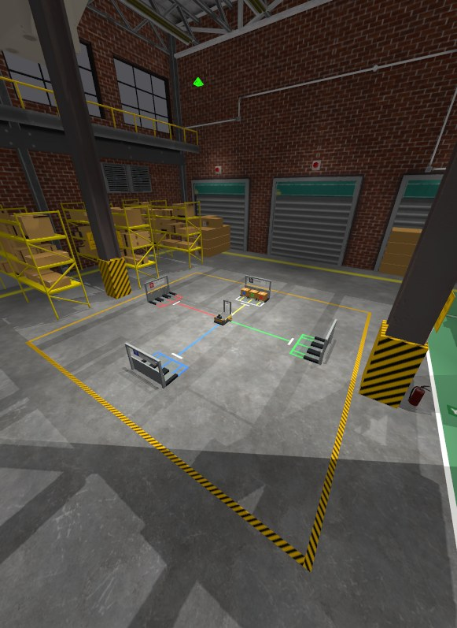 Gazebo GUI açılış görüntüsü (gerçek ekran görüntüsü) | 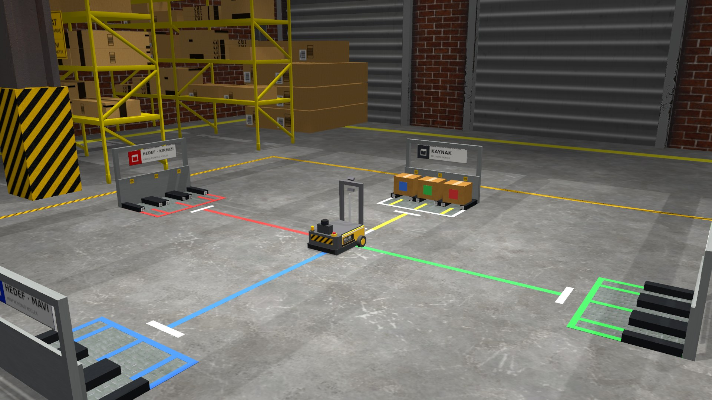 Hücre |
| 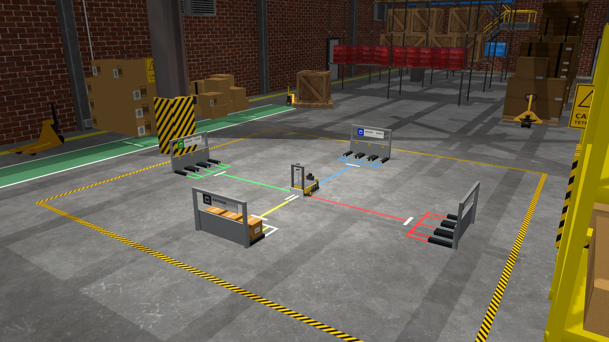 Hücre, kepenk tarafından | 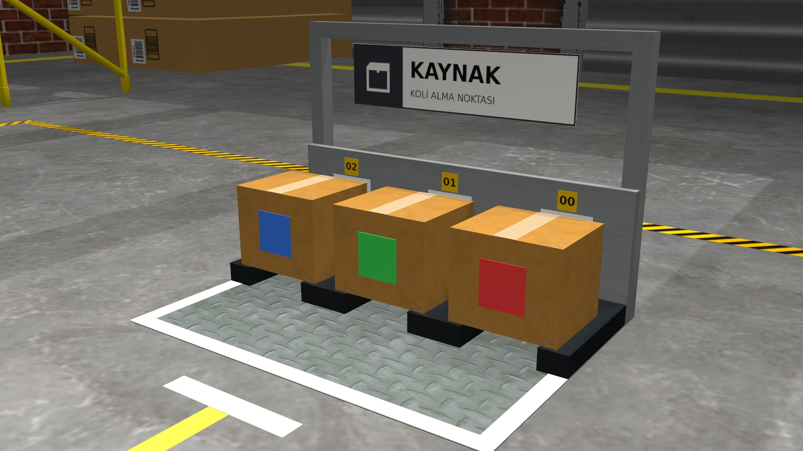 Kaynak istasyon |
| 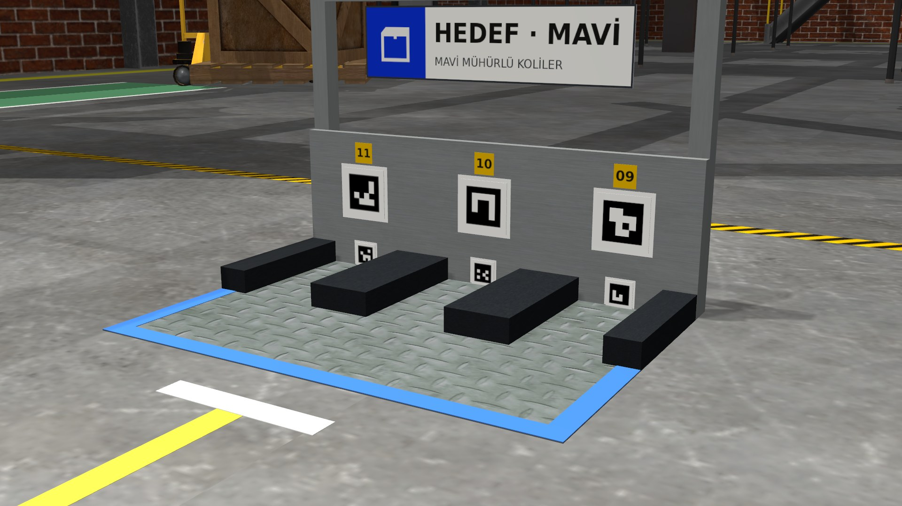 Boş hedef istasyon: etiket plakaları, bölme numaraları | 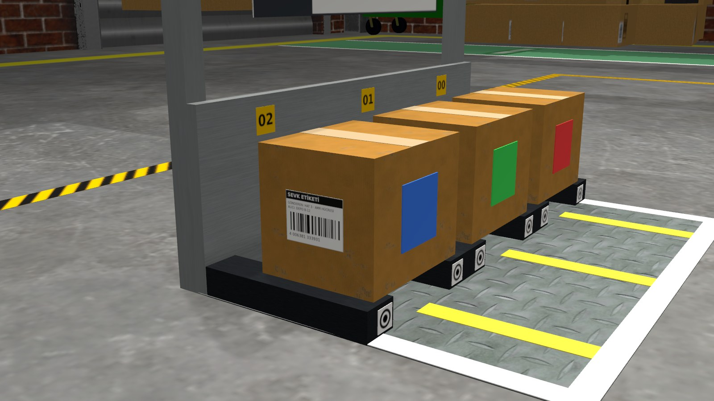 Koli: bant, sevk etiketi, mühür |
| 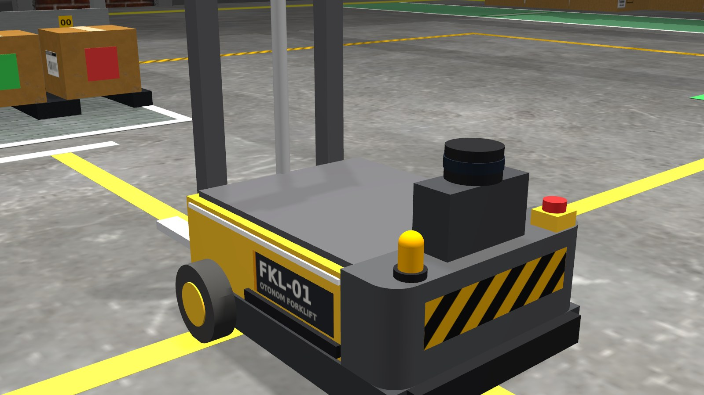 Robot, arka | 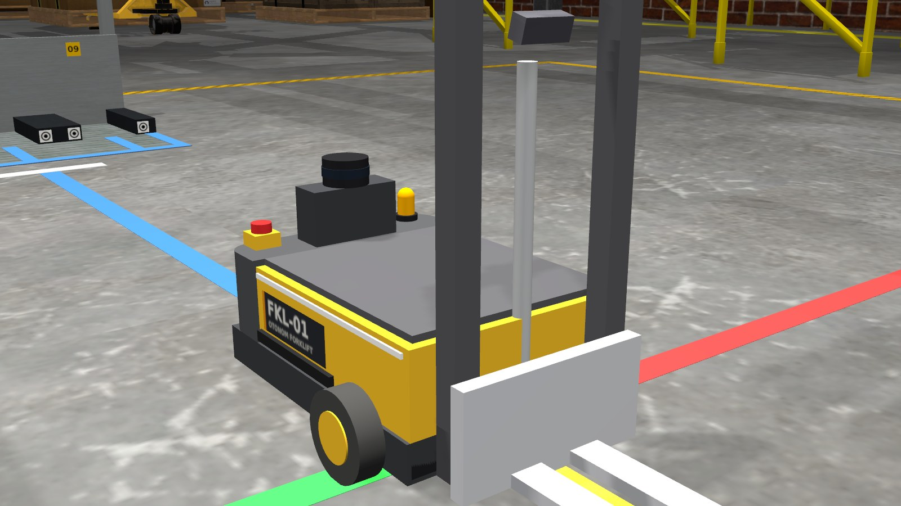 Robot, ön |
| 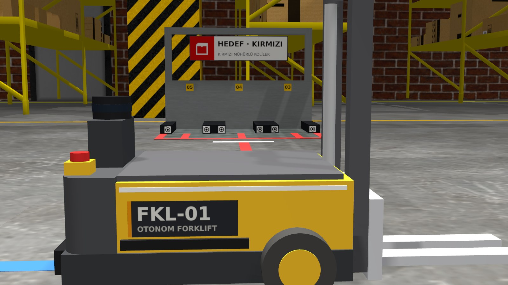 Robot, yan | 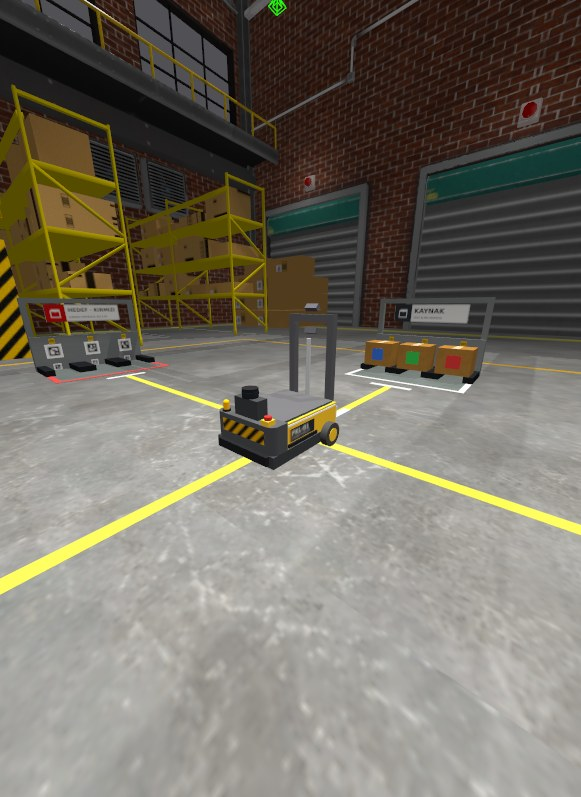 Robot, Gazebo GUI'de (gerçek ekran görüntüsü) |
| 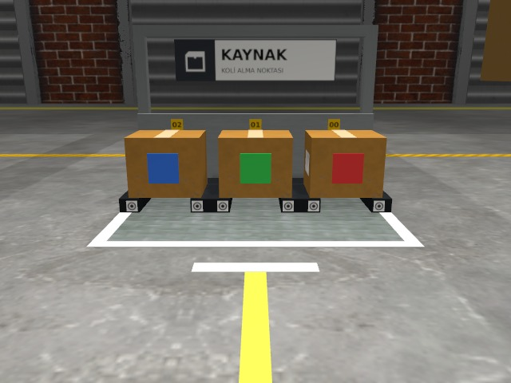 Ön kamera (spawn pozu) | 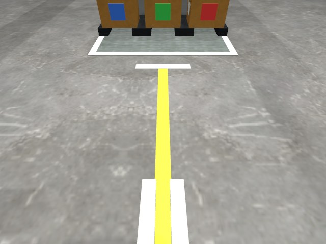 Şerit kamerası (spawn pozu) |
| 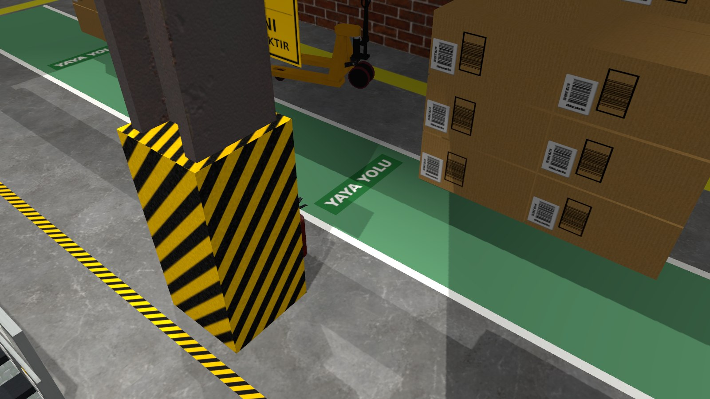 Kolon koruyucu, levhalar, yaya yolu | 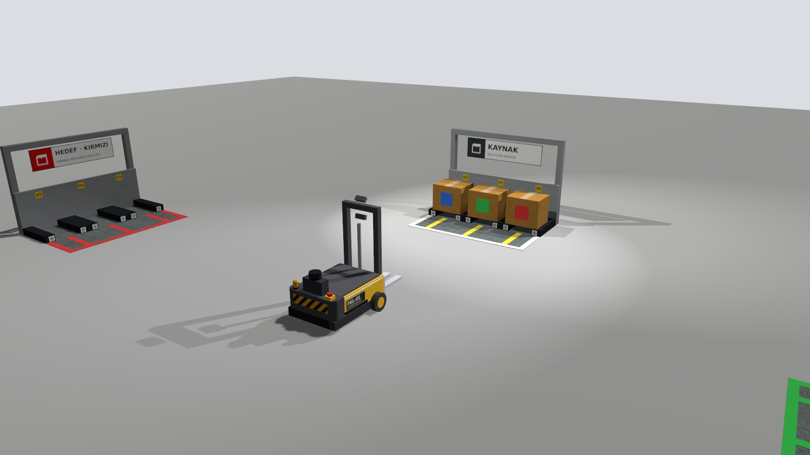 Yeni görünüm, station_test'te |

GUI ekran görüntüleri dışındaki kareler, ekransız render edilen önizleme
dünyalarındaki kamera sensörlerinden alındı. Bu dünyalar gerçek modellerden
(xacro → SDF) ve aynı `factory.sdf`'ten oluşturuldu.

## 8. Çalıştırılmayan testler ve doğrulanmamış varsayımlar

| Test | Durum | Neden |
|---|---|---|
| S3–S7 (station_test) | **ÇALIŞTIRILMADI** | Sahibin kararı: CV aşamasına ertelendi. İstasyon/koli görünümü değiştiği için yeniden koşulmalı. `docs/station_test_results.md` içindeki S3–S7 satırları 2026-10-19 tarihli eski görünüme ait; S1/S2 satırları bu oturumdaki koşu |
| S3–S7 (factory) | **ÇALIŞTIRILMADI** | Aynı neden. `station_acceptance.py` şu an yalnız station_test'i açıyor; factory için dünya seçimi eklenmeli |
| S8 | **ÇALIŞTIRILMADI** | Performans §6'daki ayrı ölçümle yapıldı; S8'in kendisi koşulmadı |
| T1–T14 (lift_test) | **ÇALIŞTIRILMADI** | Robotta yalnız visual değişti ve fizik öğeleri birebir aynı (§5.2). Yine de T12 (görüş) CV aşamasında yeniden koşulmalı |
| RViz'de robot görünümü | **KONTROL EDİLDİ (sonradan)** | İlk sürümde gövde RViz'de siyahtı: RViz bir link'in tüm visual'larını ilk visual'ın malzemesiyle çiziyor (D-54). Sarı gövde ilk visual yapıldı; yalıtılmış Xephyr ekranında `display.launch.py` ile doğrulandı, görsel `docs/images/factory/rviz_robot.png` |
| İlk çalıştırmada Fuel indirmesi | **ÖLÇÜLMEDİ** | Modeller önbellekteydi |

## 9. Bilinen sorunlar ve sınırlar

- **Görsel tavan:** Gazebo Harmonic/ogre2'de global illumination ve ambient
  occlusion yok. Depot'un baked lightmap'i holü kurtarıyor, ama bizim
  modellerimiz yalnız gerçek zamanlı ışıkla aydınlanıyor.
- **Yansımalar:** Depot zemini spot ışık altında hafif parlak; ışıkların
  specular değeri düşük tutuldu.
- **Taşıyıcı plaka:** Açık gri, beyaza yakın duruyor. Kameraların görüş alanında
  olduğu için T12 kanıtlarını korumak adına değiştirilmedi.
- **Duvar collision'ı:** Depot duvarlarının collision'ı yok, robot duvardan
  geçebilir. Hücrede çalışırken etkisi yok.
- **Kamera gürültüsü:** Hâlâ uygulanmıyor (REPORT_STATIONS §12.1). Bu
  çalışmanın kapsamında değildi.
- **RViz renkleri:** RViz her link'i tek renkle çiziyor (D-54). Ayrıntılı
  renkler yalnız Gazebo'da görünür.
- **README görselleri** güncel sürümle yeniden alındı. Eski görseller
  raporlarda test kanıtı olarak duruyor; eski sürümler `release/v0.1.0`,
  `release/v0.2.0` dallarında ve aynı adlı tag'lerde.

## 10. Açık kararlar (sahibin)

1. Genel görünümün onayı veya değişiklik istekleri (sahip "şimdilik dursun" dedi).
2. `hall.clutter` varsayılanı: `full` (şu an) veya `clean`.
3. Önceden açık olan **S5 yaw kriteri** (REPORT_STATIONS §10, D-51) hâlâ açık.

## 11. Nasıl çalıştırılır

```bash
cd ~/cv_forklift_ws
colcon build --packages-select forklift_description forklift_gazebo forklift_bringup
source install/setup.bash

ros2 launch forklift_gazebo station_sim.launch.py station_world:=factory   # fabrika + istasyonlar
ros2 launch forklift_bringup bringup.launch.py world:=factory              # + RViz + operatör GUI'si

# Performans ölçümü (~10 dk; GUI'li ölçümlerde pencere açılır)
ros2 run forklift_gazebo measure_sim_performance.py --out /tmp/perf
ros2 run forklift_gazebo measure_sim_performance.py --worlds factory --gui false --factory-clutter full,clean

# Yerleşimi değiştirmek: src/forklift_gazebo/config/factory.yaml düzenlenir,
# ardından yeniden build (factory.sdf ve factory_lanes.yaml yeniden üretilir)
```

İlk çalıştırmada Depot ve diğer Fuel modelleri (~100 MB) internetten indirilir
(`~/.gz/fuel`). Sonraki çalıştırmalar çevrimdışı açılır.
