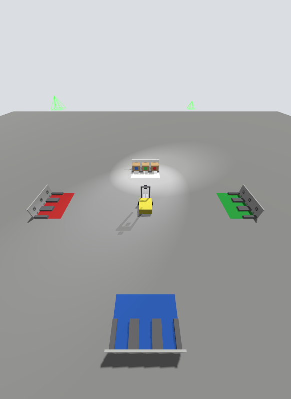
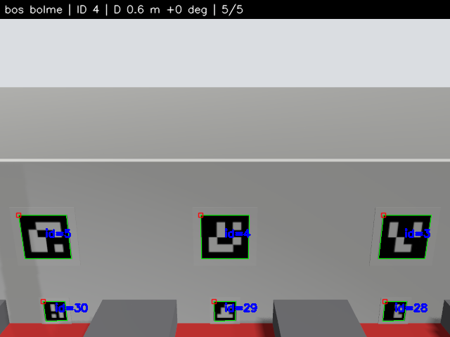
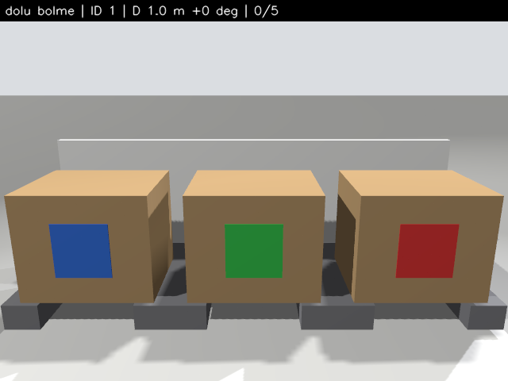
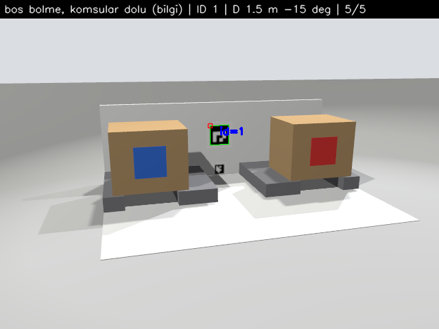
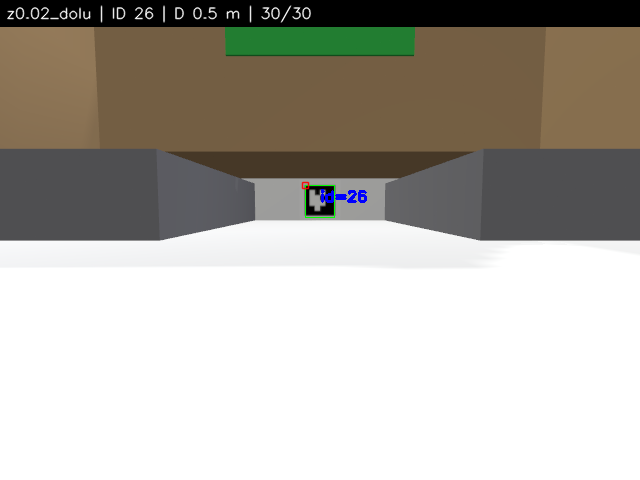
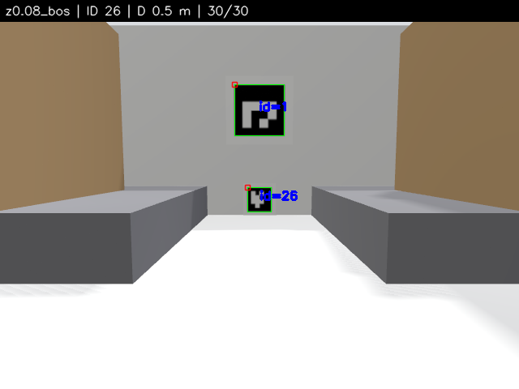
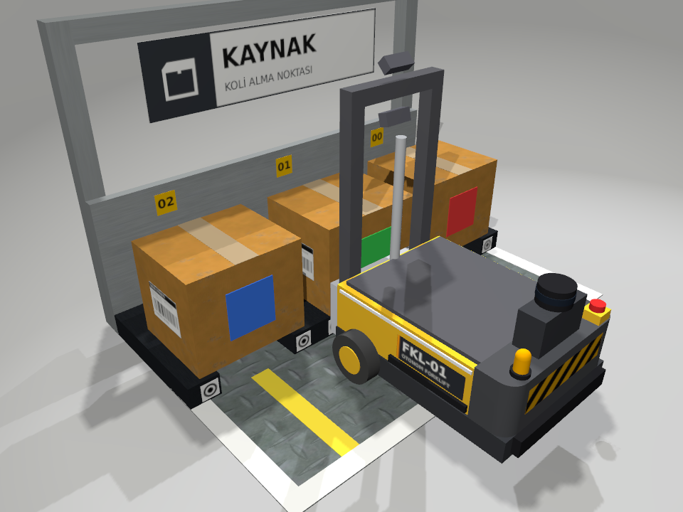
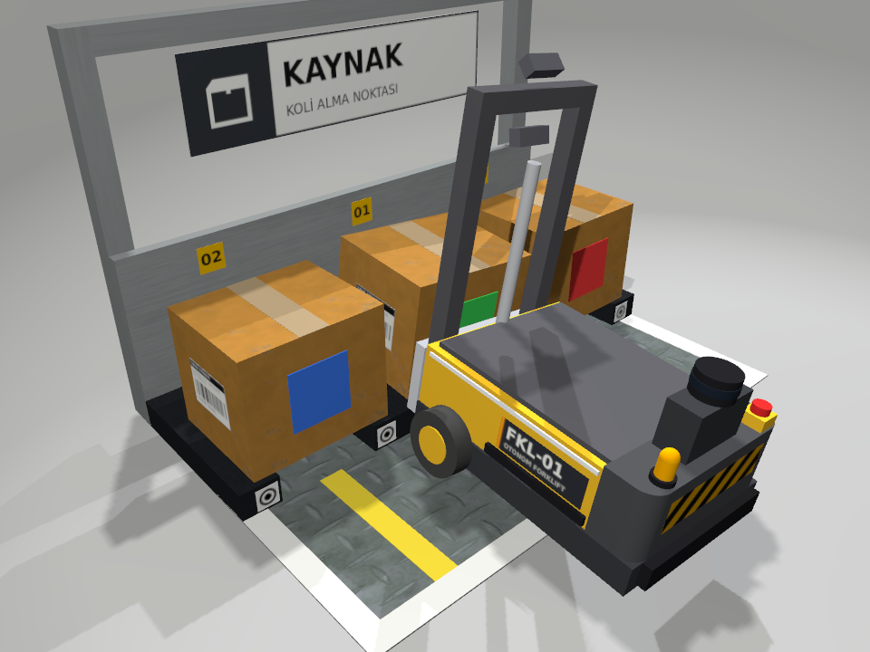
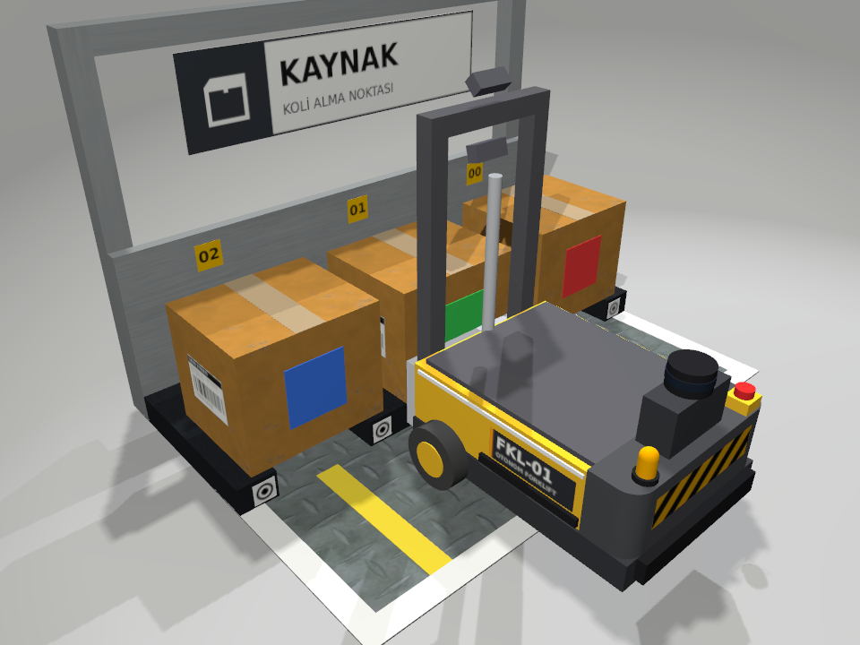
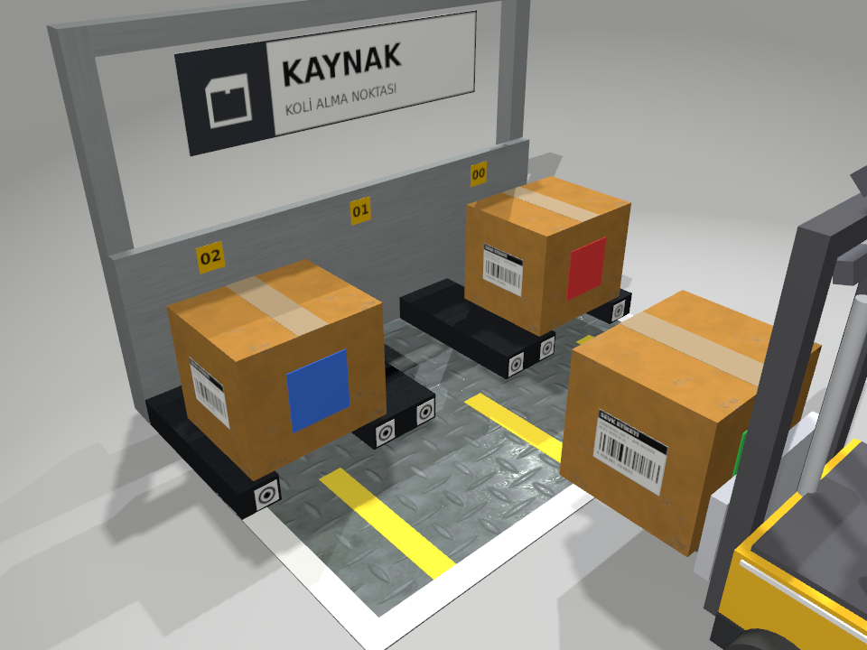

# Yük İstasyonu ve Koli — Rapor

Branch: `feature/stations` · Tarih: 2026-10-19 · Ortam: Ubuntu 24.04, ROS 2 Jazzy,
Gazebo Sim 8.15.0 (Harmonic), sdformat 14.9.0, OpenCV 4.6.0, xacro 2.1.1.
Kararların ayrıntısı `DECISIONS.md` D-43 … D-51'de, mimari `ARCHITECTURE.md` §8'de.

> **Not (2026-10-21):** Bu rapor v0.2.0 tasarımını (ArUco işaretli istasyonlar)
> anlatır. ArUco işaretleri D-56 ile kaldırıldı; S4/S5 testleri artık yok
> (sonuç tablosunda KALDIRILDI). İstasyon kimliği tabeladan, son hizalama
> daire hedeflerden (§13, D-55), yanaşma bölme şeridinden gelir. Bu tasarımın
> hâli `release/v0.2.0` dalında duruyor.

---

## 1. Özet

`forklift_gazebo` paketine N bölmeli, statik ve parametrik bir yük istasyonu
(`station.sdf.xacro`), 0.24 × 0.20 × 0.20 m'lik mühürlü yeni bir koli
(`parcel.sdf.xacro`) ve bunları `config/stations.yaml`'dan spawn eden
`station_test` dünyası eklendi. Tüm ölçüler `config/station_params.yaml`'dan
gelir. Her bölmede iki ArUco işareti var: koli varken gizlenen üst işaret (ID k)
ve kanal tünelinden görünen alt işaret (ID k + 25). Dokuları build sırasında
üretilir. S1–S8 kabul testlerinden **yedisi geçti**. **S5 kaldı**: alt işaret
0.2–0.8 m'de, koli varken de yokken de doğru ID ile tespit ediliyor ve yanal poz
hatası ≤ 1.6 mm. Ancak 4 cm'lik işaret 0.5 m'den bakıldığında yaw hatası
+21.6°. Bu, ölçüm hatası değil fiziksel bir gözlenebilirlik sınırı; geometri
veya kriter kararı sizde (§6, §10). Robot, GUI ve otonomiye dokunulmadı.

## 2. Eklenen ve değişen dosyalar

| Dosya | Görevi |
|---|---|
| `src/forklift_gazebo/config/station_params.yaml` | İstasyon, işaret, koli, renk ve detektör parametrelerinin tek kaynağı |
| `src/forklift_gazebo/config/stations.yaml` | `station_test` yerleşimi: istasyon pozları, bölme sayısı, k numaraları, doluluk |
| `src/forklift_gazebo/xacro/common.sdf.xacro` | Mat malzeme, kutu ataleti ve kutu parçası makroları |
| `src/forklift_gazebo/xacro/station.sdf.xacro` | N bölmeli statik istasyon; `bay_i` çerçeveleri ve işaret visual'ları |
| `src/forklift_gazebo/xacro/parcel.sdf.xacro` | Renk argümanlı koli; atalet geometriden |
| `src/forklift_gazebo/scripts/station_layout.py` | Bölme y'si, ID şeması, işaret/koli pozları ve yerleşim doğrulaması (ortak modül) |
| `src/forklift_gazebo/scripts/generate_aruco_textures.py` | Build adımı: 50 ArUco PNG'si ve `markers.yaml` |
| `src/forklift_gazebo/launch/stations.launch.py` | `stations.yaml` → xacro → `ros_gz_sim create`; koliler istasyonlardan sonra |
| `src/forklift_gazebo/launch/station_sim.launch.py` | `sim.launch.py` (`station_test`) + `stations.launch.py` |
| `src/forklift_gazebo/worlds/station_test.sdf` | Fizik, sistemler ve ışıklar `lift_test` ile aynı; nesne yok |
| `src/forklift_gazebo/scripts/station_acceptance.py` | S1–S8 otomasyonu (yalnız gz-transport ve `gz service`) |
| `src/forklift_gazebo/CMakeLists.txt`, `package.xml` | Doku ve `markers.yaml` üretimi, kurulum, `python3-opencv` bağımlılığı |
| `src/forklift_bringup/launch/bringup.launch.py` | `world:=lift_test\|station_test` (varsayılan değişmedi) |
| `.gitignore` | Kaynak ağaçta üretilmiş PNG ve `markers.yaml` olmasın |
| `ARCHITECTURE.md` §1, §8 · `DECISIONS.md` D-43 … D-51 · `README.md` | Belgeler (İngilizce) |
| `docs/station_test_results.{md,json}`, `docs/logs/stations/`, `docs/images/stations/` | Test kanıtları |

Dokunulmayanlar: `forklift_description`, `forklift_gui`, `forklift_safety`,
`sim.launch.py`, `lift_test.sdf`, `test_parcel`, `acceptance_test.py`.

## 3. Çerçeveler ve ölçülü şema

* **`station`:** Model çerçevesi. Orijin zeminde, ön kenarın ortasında; +x
  istasyonun içine (çatalın girdiği yön), +y sol, +z yukarı.
* **`bay_i`:** SDF'te `<frame name="bay_i">`. Orijin zeminde, kanal ekseninde,
  ön kenarda; eksenler `station` ile aynı. `y_i = (i − (N−1)/2) · 0.30`. Bölme
  0 en −y tarafta, yani istasyona bakarken sağda.
* **İşaret:** OpenCV ArUco çerçevesi. Orijin siyah karenin merkezi; x sağ,
  y yukarı (−x'ten bakan kameraya göre), z işaretten dışarı (−x_station).
  Dokulu ön yüz x = 0.2985'te: arka plaka ön yüzü 0.30 − 0.5 mm boşluk − 1 mm
  kalınlık.
* **Tam giriş:** Taşıyıcı ön yüzü bölme x = 0'da. `base_link` x = −0.13, çatal
  ucu 0.25, arka plakaya 5 cm kalır.

Ölçekli değildir; değerler `station_params.yaml`'dandır:

```
üstten: +x yukarı (istasyonun içine), +y sol; N = 3, metre
  x
 0.32 ┌──────────────────────────────────────────────────────────────────────────────┐
      │                           arka plaka (beyaz) 0.02                            │
 0.30 ├────────┬────────────┬──────────┬────────────┬──────────┬────────────┬────────┤
      │çıkıntı │   kanal    │ çıkıntı  │   kanal    │ çıkıntı  │   kanal    │çıkıntı │
      │ 0.065  │  bölme 2   │   0.13   │  bölme 1   │   0.13   │  bölme 0   │ 0.065  │
      │        │    0.17    │          │    0.17    │          │    0.17    │        │
 0    ├────────┴────────────┴──────────┴────────────┴──────────┴────────────┴────────┤  ← istasyon ön kenarı (x = 0), orijin ortasında
      │                    önlük = zemin plakası (istasyon rengi)                    │
-0.30 └──────────────────────────────────────────────────────────────────────────────┘
    +0.45           +0.30                     0                     −0.30          −0.45   (y; bölme eksenleri y_i)

önden: robotun baktığı gibi +x yönüne (+y sol, −y sağ); N = 3
  z
 0.30 ┌──────────────────────────────────────────────────────────────────────────────┐  arka plaka (beyaz), z 0 … 0.30
      │             [k₂]                    [k₁]                    [k₀]             │  üst işaret 0.08, merkez z 0.17
      │                                                                              │
 0.05 ├────────┬────────────┬──────────┬────────────┬──────────┬────────────┬────────┤  çıkıntı üstü z 0.05; alt işaret 0.04, merkez z 0.028
      │çıkıntı │  [k₂+25]   │ çıkıntı  │  [k₁+25]   │ çıkıntı  │  [k₀+25]   │çıkıntı │
 0    └────────┴────────────┴──────────┴────────────┴──────────┴────────────┴────────┘  zemin plakası 0.002
    +0.45           +0.30                     0                     −0.30          −0.45   (y)
```

İşaretlerin z aralıkları (siyah kare / beyaz kenar dahil doku): alt işaret
0.008–0.048 / 0.0013–0.0547, üst işaret 0.130–0.210 / 0.117–0.223. Koli bölmede
x ∈ [0.01, 0.21], z ∈ [0.05, 0.25] aralığını kaplar.

`station_test` yerleşimi (robot orijinde, +x'e bakar):

| İstasyon | Poz [x, y, yaw] | k | Doluluk |
|---|---|---|---|
| `source` (neutral) | 1.5, 0, 0 | 0, 1, 2 | kırmızı, yeşil, mavi |
| `dest_red` (solda) | 0, 2.25, π/2 | 3, 4, 5 | boş |
| `dest_green` (sağda) | 0, −2.25, −π/2 | 6, 7, 8 | boş |
| `dest_blue` (arkada) | −2.25, 0, π | 9, 10, 11 | boş |

Önlük dahil ayak izleri arasındaki en küçük boşluk 1.68 m.

## 4. Türetilmiş toleranslar: hesap ve test

Hesaplar `forklift_params.yaml` ve `station_params.yaml`'dan bir betikle
yapıldı. Test sütunu S6/S7'nin ölçümleridir (`docs/logs/stations/S6_trials.json`,
`S7_pick.json`).

| Kontrol | Hesap | Test sonucu |
|---|---|---|
| Çatal kanal boşluğu | (0.17 − 0.12) / 2 = ±25 mm | ±2.5 cm'de çatal kanal kenarına değiyor ama bırakma başarılı. ±3 cm'de çatal 5 mm çıkıntıya biniyor: robot 6.5° yalpa ve 4.4° yunuslama yapıyor, geri ancak 1 cm çekilebiliyor |
| Koli çıkıntı örtüşmesi | Merkezde 35 mm; 10 mm minimumla ±25 mm | Ölçülen dar taraf örtüşmesi 0 / ±1 / ±2 / ±2.5 cm'de 35.0 / 25.0 / 15.0 / 10.0 mm |
| Taşıma yüksekliği (eklem 0.06) | Çatal alt yüzü 0.070 > 0.05 | Robot taşıma yüksekliğinde tam giriş pozuna konunca çıkıntılarla temas yok. Koli tabanı çatalda 88.6 mm |
| Bırakma | Eklem 0.025'te çatal üstü 0.05; eklem 0'da çatal kanalda serbest | 0–±2.5 cm: eklem 0.0 mm, koli tabanı 50.0 mm, eğim 0.00°, geri çekilmede sürüklenme 0.0 mm |
| Tam giriş derinliği | Çatal ucu 0.25 → arka plakaya 50 mm | Koli merkezi bölmede x = 0.101 m (önü 0.0013); arka plakayla temas yok |
| Robot gövdesi | Şasi önü −0.050, teker önü −0.080, dikme −0.020, taşıyıcı 0.000 | Kanala yalnız çatal giriyor. Komşu kolilerin tüm S6 denemeleri (±3 cm dahil) sonundaki yer değiştirmesi 0.000 mm |
| Zemin plakası etkisi (D-46) | Yaklaşık 0.4° burun yukarı | Tam girişte yunuslama −0.41° (REP-103'te eksi = burun yukarı) |
| Alma (eklem 0 → 0.06) | Çatal üstü 0.025 → 0.085; koli 3.5 cm kalkar | Girişte koli 0.00 mm oynadı; kaldırınca taban 88.8 mm; 0.5 m geri çekilmede bağıl kayma 0.00 mm |

## 5. İşaret ID şeması ve `markers.yaml`

* Sözlük DICT_4X4_50. Bölme numarası k ∈ [0, 24], tüm istasyonlarda benzersiz
  (`stations.yaml → bay_ids`). **Üst ID = k, alt ID = k + 25** (D-45). Aynı ID'yi
  iki boyutta kullanmak poz kestiriminde uzaklığı iki kat yanlış verirdi.
* Doku: 6 hücrelik işaret + her yanda 1 hücrelik beyaz kenar = 8 hücre, hücre
  başına 100 px, yani 800 × 800 PNG. Şemadaki 50 ID'nin hepsi build'de üretilir
  ve geri okunarak doğrulanır (D-47).
* `share/forklift_gazebo/config/markers.yaml` build'de `stations.yaml`'dan
  üretilir; `stations.yaml` değişince yeniden build gerekir. Örnek
  (`source`, bölme 1):

```yaml
dictionary: DICT_4X4_50
markers:
- id: 1
  station: source
  bay: 1
  bay_id: 1
  type: upper
  size: 0.08
  pose_station:
    xyz: [0.2985, 0.0, 0.17]
    rpy: [1.570796327, 0.0, -1.570796327]
  pose_world:
    xyz: [1.7985, 0.0, 0.17]
    rpy: [1.570796327, 0.0, -1.570796327]
- id: 26
  station: source
  bay: 1
  bay_id: 1
  type: lower
  size: 0.04
  pose_station:
    xyz: [0.2985, 0.0, 0.028]
    rpy: [1.570796327, 0.0, -1.570796327]
  pose_world:
    xyz: [1.7985, 0.0, 0.028]
    rpy: [1.570796327, 0.0, -1.570796327]
```

Dosyada ayrıca istasyon pozları ve çerçeve tanımları var. `rpy` işaret
çerçevesinin yönelimidir: x_m = −y_s, y_m = +z_s, z_m = −x_s.

## 6. Test sonuçları (S1–S8)

Son tam koşu 2026-10-19 19:51 (`ros2 run forklift_gazebo station_acceptance.py`, ekransız EGL); S6/S7 komşu koli denetimi eklendikten sonra 19:59'da yeniden koşuldu. Ölçümler deterministik; önceki tekil koşularla birebir aynı.
Ham çıktı `docs/station_test_results.{md,json}`, ayrıntılar `docs/logs/stations/`.

| # | Test | Ölçülen | Kriter | Sonuç |
|---|---|---|---|---|
| S1 | xacro → SDF, `gz sdf -k` | 15/15 dosya "Valid.", xacro ve gz uyarısı yok | N = 1, 3, 5 × 4 istasyon rengi + 3 koli rengi; hata/uyarı yok | **GEÇTİ** |
| S2 | Geometri denetimi | 1154 denetim, 0 hata, en büyük sapma 0.0000 mm; 24 işaret `markers.yaml` ile, 50 doku ID ile uyumlu | Kanal, adım, çıkıntı, plakalar, işaret konum/boyut, koli: YAML ±0.5 mm | **GEÇTİ** |
| S3 | Statik kararlılık | Üç koli: spawn pozundan en çok 4.6·10⁻⁸ mm, eğim 0° (10 s sim) | Hiçbir koli > 1 mm hareket etmiyor | **GEÇTİ** |
| S4 | Üst işaret tespiti | Boş bölme ID 4: 9/9 görüşte 5/5 karede tespit. Dolu bölme ID 1: 9/9 görüşte hiç tespit yok. Bilinmeyen/gizli ID yok | 0.6 / 1.0 / 1.5 m × 0°, ±15° | **GEÇTİ** |
| S5 | Alt işaret tespiti | Tespit: z 0.02 koli var 7/7, koli yok 7/7, z 0.08 koli yok 7/7 mesafe. Poz @0.5 m: yanal −0.81 / −0.81 / −0.72 mm; **yaw +21.6 / +21.6 / +16.9°** | 0.2–0.8 m doğru ID; @0.5 m yanal < 5 mm, yaw < 1° | **KALDI** (yaw) |
| S6 | Bırakma toleransı | 0, ±1, ±2 cm (ve bilgi ±2.5): eklem 0.0 mm, taban 50.0 mm, eğim 0.00°, sürüklenme 0.0 mm. ±3 cm: eklem 2.1 mm, taban 65.5 mm, eğim 7.86°, sürüklenme 44.9 mm, geri 0.01 m. Gözlenen sınır ±2.5 cm. Komşu koliler 0.000 mm | 0–±2 cm başarılı, ±3 cm başarısız bekleniyor | **GEÇTİ** |
| S7 | Alma | Girişte koli 0.00 mm oynadı; taban 50 → 88.8 mm; 0.501 m geri sonrası koli çatalda, bağıl kayma 0.00 mm | Bağıl kayma < 1 cm | **GEÇTİ** |
| S8 | Performans | RTF 1.001 (20 s, ekransız EGL); kameralar 30.3 / 30.3 Hz | RTF ≥ 0.9, iki kamera açık | **GEÇTİ** |

**Regresyon (mevcut testleri bozma şartı):** Eski `acceptance_test.py`
(T1–T14) bu değişikliklerden sonra, 2026-10-19'da, repodaki kanıtların üzerine
yazmamak için ayrı bir çıktı dizinine (`--docs`) çalıştırıldı: **14/14 GEÇTİ**.
T2 tüm workspace'i uyarısız build ediyor. `lift_test.sdf`, `test_parcel` ve
robot değişmedi.

Ayrıntılar ve yorum:

* **S2:** 1154 denetim yapıldı: N = 1 / 3 / 5, `stations.yaml`'daki dört
  istasyon, `markers.yaml`, 50 dokunun boyutu, beyaz kenarı ve ID'si, üç koli.
  Kasıtlı bozulmuş bir SDF'le (kanal 1.5 mm, işaret 1.1 mm kaydırılmış) negatif
  kontrol yapıldı; hatalar yakalandı.
* **S3:** Kolilerin spawn pozundan sapması ölçüm çözünürlüğünün altında
  (10⁻⁸ m mertebesi). Kolilerin gerçekten simüle edildiği S6/S7'de görülüyor:
  aynı koliler kaldırılıp bırakıldı, ±3 cm'de devrildi.
* **S4:** 27 görüş, her biri 5 kare. Boş bölmede ID 4 her görüşte 5/5.
  Dolu bölmede ID 1 hiçbir karede görünmedi; komşu dolu bölmelerin ID 0 ve 2'si
  de görünmedi. Bilgi grubu (orta bölme boş, komşular dolu) 9/9. Bilgi amaçlı
  uzaklık kestirimi sistematik olarak uzun çıkıyor: 0.6 / 1.0 / 1.5 m'de
  +1.5 / +2.5 / +3.7 % (§9).
* **S5:** Tespit ölçütü 0.2–0.8 m'de üç değerlendirilen durumda tamam (7/7 mesafe).
  Varsayılan detektör parametreleriyle 0.6 m (z 0.02) ve 0.7–0.8 m'de (z 0.08)
  doku örneklemesi yüzünden kayıp vardı. `perspectiveRemoveIgnoredMarginPerCell`
  0.3 ile giderildi (D-50; 0.25–0.45 platosu). z 0.08 + koli kombinasyonu
  bilgi amaçlı (D-48): geçerli tüm mesafelerde tespit yok, beklendiği gibi.
  0.2 m'de kamera kolinin içine düştüğü için görüş geçersiz sayıldı (render
  arka yüzleri çizmediği için işaret "görünüyor"). Poz (0.5 m): yanal
  −0.81 / −0.81 / −0.72 mm, **geçti**. Yaw +21.6 / +21.6 / +16.9°, **kaldı**.
  Nedeni §10'da.
* **S6:** Ofsetler 0, ±1, ±2 (değerlendirilen), ±2.5 (bilgi) ve ±3 cm. Gözlenen
  sınır ±2.5 ile ±3 cm arasında. ±3 cm'de beklenen başarısızlık oluştu; mekanizma
  "çatal çıkıntıya oturuyor"dan biraz farklı. Kaldırma denetleyicisi aşağı
  itmeye devam ettiği için eklem 2.1 mm'ye kadar iniyor ve robotun önü
  kalkıyor (yalpa 6.5°, yunuslama 4.4°). Koli 7.9° eğiliyor ve robot geri
  çekilemiyor (1 cm).
* **S7:** Koli 0.5 m boyunca çatalda; bağıl kayma 0.00 mm (μ 0.8, düz yol,
  0.15 m/s).
* **S8:** Tam dünya (4 istasyon, 3 koli, robot), iki robot kamerası abone, 20 s.

## 7. Görseller

Etiketler ASCII'dir (OpenCV yazı tipi Türkçe harf çizemiyor). S6/S7 görüntüleri
teste özel, statik bir **belgeleme kamerasının gz render'ıdır**, GUI ekran
görüntüsü değildir. Genel görünüm Gazebo GUI'nin `/gui/screenshot` servisiyle
alındı.

| | |
|---|---|
|  |  |
| Gazebo GUI: `station_test` | S4: ön kamera, boş `dest_red`, 0.6 m, 0°; üst (3–5) ve alt (28–30) işaretler |
|  |  |
| S4: dolu kaynak istasyon, 1.0 m; üst işaretler kolilerin arkasında | S4 bilgi: orta bölme boş, komşular dolu, 1.5 m, −15° |
|  |  |
| S5: z 0.02, koli var, 0.5 m; ID 26 kanal tünelinden | S5: z 0.08, koli yok, 0.5 m; alt (26) ve üst (1) |
|  |  |
| S6: 0 cm ofset, çatal indirildikten sonra (render) | S6: +3 cm, çatal çıkıntıda, koli eğik, robot yatmış (render) |
|  |  |
| S6: +2 cm, bırakma başarılı (render) | S7: 0.5 m geri çekilme sonrası koli çatalda (render) |

Tüm görüşlerin karo mozaikleri: `docs/images/stations/s4_montage_{0,1,2}.png`
ve `s5_montage_*.png`.

## 8. Spesifikasyondan sapmalar

| # | Sapma | Gerekçe |
|---|---|---|
| D-44 | Alt işaret merkezi z 0.025 → 0.028 (siyah 0.008–0.048) | Bir hücrelik (6.7 mm) beyaz kenar zemine sığmıyordu |
| D-45 | Üst ID = k, alt ID = k + 25 | Aynı ID iki boyutta kullanılırsa poz kestirimi uzaklığı yanlış verir |
| D-46 | Zemin plakası collision'lı (Faz 1 önerisi görsel-yalnızdı) | Sizin kararınız; etkisi ölçüldü: −0.41° yunuslama |
| D-48 | S5'te z 0.08 yalnız koli yokken değerlendirildi; S4 mesafe ve açı tanımı; S6/S7 yeri ve eşikleri | z 0.08 + koli kombinasyonunda görüş hattı yok (onaylandı) |
| D-50 | ArUco detektör parametresi `perspectiveRemoveIgnoredMarginPerCell` = 0.3 | Varsayılanla 25–30 px'te monoton olmayan kayıplar |
| D-49 | S5 test kamerası statik değil; yerçekimsiz, collision'sız dinamik model | Her görüşte yeniden spawn > 5 s sürüyor; `set_pose` ile taşınıp gerçek pozu doğrulanabiliyor |
| — | Test dosyası `test/` yerine `scripts/station_acceptance.py` | Mevcut düzen (`scripts/acceptance_test.py`) |
| — | S6'ya ±2.5 cm (bilgi) eklendi; S4'e "orta bölme boş, komşular dolu" bilgi grubu eklendi; S5'e yaw/yanal duyarlılık taraması eklendi | Sınırı ve gözlenebilirliği netleştirmek için; değerlendirmeye katılmadılar |
| — | `markers.yaml` dünya pozlarını da içeriyor; 50 ID'nin hepsinin dokusu üretiliyor | Algılama node'u için kolaylık; `stations.yaml` değişse de doku eksik kalmaz |

## 9. Doğrulanamayan varsayımlar ve bilinen sorunlar

1. **Kamera gürültüsü uygulanmıyor (robot kapsamı).** Robotun iki kamerası ve
   S5 kamerası σ = 0.007 Gauss gürültüsü tanımlıyor. Ardışık kareler aynı
   (ortalama fark 0.001 gri düzey) ve gökyüzü bölgesinin uzamsal saçılımı tam 0.
   Hem ekransız EGL'de hem pencereli kipte (`lift_test`) ölçüldü. Bu yüzden
   S5'teki "30 kare ortalaması" tek bir deterministik örnektir; tespit sonuçları
   gürültüsüz görüntüye aittir. Nedenini araştırmadım (robot kapsam dışı); §12.
2. **gz-transport Python `request()` sorunu (D-49).** Test sürecinde sürekli
   abonelikler varken `create/blocking` hiç dönmedi, `set_pose` ara sıra 5 s
   bekledi. Tek abonelikli basit bir betikte tekrar üretilemedi, yani mekanizma
   kanıtlanmadı. Servis çağrıları `gz service` CLI üzerinden yapılıyor.
3. **Asenkron `/create`** ad çakışmasında da `data: true` dönüyor (ölçüldü). Test
   `/blocking` varyantlarını kullanıyor.
4. **Detektör parametresi test kareleri üzerinde ayarlandı.** 0.25–0.45
   platosu aşırı uyumu azaltıyor ama gerçek kamerada (gürültü, bulanıklık)
   yeniden doğrulanmalı.
5. **Köşe kayması:** Render edilen siyah kare 1–2 px küçük görünüyor; alt kenar
   daha fazla etkileniyor. Sonuçlar uzaklıkta +1.5…+3.7 % sapma ve küçük
   işarette yaw belirsizliği. Doku süzme ve aydınlatma gradyanı kaynaklı
   olduğu düşünülüyor; ayrıca kanıtlanmadı.
6. **S6/S7 yerleştirmesi `set_pose` ile.** Yaklaşma sürüşü, zemin plakası
   basamağına çıkış ve sürüş sırasındaki hizalama hatası test edilmedi; robot
   tam giriş pozuna ışınlandı (spesifikasyondaki yöntem).
7. **S3 sapmasının sıfıra yakınlığı** DART'ın temastaki kararlılığından
   geliyor. Gerçek bir fizik motorunda veya farklı adımda değişebilir.
8. **Statik modelde `set_pose`** test edilmedi (S5 kamerası bu yüzden dinamik).
9. **Doku yönü** ekransız bir sondada ve S4/S5 tespitlerinde doğrulandı (ID
   doğru, 0. köşe sol üstte). Kutunun diğer yüzlerinde de doku var ama hiçbiri
   kameraya bakmıyor.
10. Kapsam dışı not: `ARCHITECTURE.md`, repo'da olmayan `REPORT_GUI.md`'ye
    atıf yapıyor.

## 10. Çatal kamerası adımı için çıkarımlar

**S5 test kamerası:** Bölme ekseninde (y = y_i), işaretin dokulu yüzünden
D = 0.2…0.8 m geride. Yükseklik z = 0.02 (eklem 0'da çatal üstünün hemen
altı) ve 0.08 (taşıma, eklem 0.06). 5° aşağı bakış, HFOV 80°, 640 × 480,
gürültü tanımı robot kameralarıyla aynı. Kamera, `source` istasyonunun orta
bölmesine (alt ID 26) bakıyor. Odak 381 px; alt işaret 0.5 m'de 31 px, 0.8 m'de
19 px.

| Durum | Tespit (0.2–0.8 m) | Yanal hata @0.5 m | Yaw hatası @0.5 m |
|---|---|---|---|
| z 0.02, koli var | 7/7 mesafe | −0.81 mm | +21.6° |
| z 0.02, koli yok | 7/7 mesafe | −0.81 mm | +21.6° |
| z 0.08, koli yok | 7/7 mesafe | −0.72 mm | +16.9° |
| z 0.08, koli var (bilgi) | 0/6 geçerli mesafe (0.2 m'de kamera kolinin içinde) | — | — |
| Tarama, z 0.02, kamera yaw −5…+5° | Hepsi tespit | ≤ 1.6 mm | ≈ +21.4° sabit |
| Tarama, z 0.02, yanal ±1/±2 cm | Hepsi tespit | ≤ 1.1 mm | +19.1 … +23.6° |

Çıkarımlar:

1. **Kamera yüksekliği:** Dolu bölmeden alırken alt işaret yalnızca koli
   tabanının (0.05) altından görülebiliyor. Çatal kamerası eklem 0'da yaklaşık
   z ≤ 0.04 olmalı ve kanal ekseninde, iki çatalın arasında durmalı. Taşıma
   yüksekliğinde (z 0.08) koli varken işaret görünmez; boş bölmeye bırakırken
   görünür.
2. **Yanal hizalama için alt işaret çok iyi:** Tüm durumlarda ≤ 1.6 mm, ±2 cm'lik
   bırakma toleransının çok altında.
3. **Yaw bu işaretten alınamaz.** 4 cm'lik işarette 0.5 m'de 1° yaw yalnızca
   0.043 px kenar farkı yaratıyor (Faz 1 hesabı). Render köşe hatası 1–2 px.
   IPPE'nin iki çözümü ±21.6° ve yeniden izdüşüm hataları neredeyse eşit; kamera
   döndürüldüğünde veya kaydırıldığında kestirim gerçek açıyı izlemiyor.
   Seçenekler (geometri değişikliği olanlar sizin onayınızı gerektirir):
   * a) **Kriter değişikliği, geometri aynı (önerim):** Yaw'ı, yaklaşma
     sırasında iki mesafede ölçülen yanal ofsetin farkından hesaplamak. Örneğin
     0.8 m ve 0.3 m'de ±1 mm hata, 0.5 m tabanla yaklaşık ±0.2° verir. S5
     kriteri "yaw < 1°" yerine "yanal < 5 mm" ve bu yöntemle bir yaw testi
     olarak yeniden tanımlanır.
   * b) **Geometri:** Bölme başına yan yana iki alt işaret (ör. y_i ± 0.05;
     kanal içinde sığıyor). 0.10 m'lik yatay taban, derinlik farkından yaw
     verir. İşaret sayısı ve ID şeması değişir.
   * c) Alt işareti büyütmek mümkün değil: tünelin yüksekliği 5 cm.
4. **Detektör ayarı:** D-50 parametresi algılama node'una da taşınmalı
   (`station_params.yaml → markers.detector`).
5. **Uzaklık kestirimi** küçük ve uzak işaretlerde sistematik olarak uzun
   çıkıyor (+1.5…+3.7 %). Mesafe kontrolünde işaret boyutu yerine yanal
   konum ve gerçek pozla kalibrasyon düşünülmeli.

## 11. Nasıl çalıştırılır

```bash
cd ~/cv_forklift_ws
colcon build --packages-select forklift_gazebo forklift_bringup   # dokular + markers.yaml üretilir
source install/setup.bash

# İstasyon dünyası (robot + istasyonlar + koliler; komut zinciri dahil)
ros2 launch forklift_gazebo station_sim.launch.py
# Aynı dünya + RViz + operatör GUI'si
ros2 launch forklift_bringup bringup.launch.py world:=station_test
# Varsayılan (değişmedi): lift_test
ros2 launch forklift_bringup bringup.launch.py

# Yerleşimi değiştirmek: src/forklift_gazebo/config/stations.yaml düzenlenir,
# ardından yeniden build (markers.yaml güncellenir)

# Tek bir model üretmek
xacro install/forklift_gazebo/share/forklift_gazebo/xacro/station.sdf.xacro bays:=5 color:=blue bay_ids:=10,11,12,13,14
xacro install/forklift_gazebo/share/forklift_gazebo/xacro/parcel.sdf.xacro color:=green

# Kabul testleri (S3–S8 kendi ekransız simülasyonunu açar; ~10 dk)
ros2 run forklift_gazebo station_acceptance.py
ros2 run forklift_gazebo station_acceptance.py --tests S1,S2        # simülasyonsuz
ros2 run forklift_gazebo station_acceptance.py --tests S4,S5 --raw-dir /tmp/raw   # ham kareler
```

Testler ROS komut zincirini kapatır (`control:=false`) ve `/cmd_vel`'e
doğrudan gz-transport ile yayın yapar. Çalışan başka bir simülasyon varsa aynı
`GZ_PARTITION`'da çakışır.

## 13. Ek (2026-10-20): kanal hizalama hedefleri (D-55)

§10'daki yaw sorunu için her bölmenin iki yanına, çıkıntıların ön yüzüne
hizalama hedefleri eklendi.

- **Konum:** Hedefler kanal kenarından 5 mm uzakta ve 5 cm'lik ön yüzün dikey
  ortasında. Çiftin orta noktası tam olarak kanal ekseni, aralarındaki taban
  0.216 m.
- **Fizik:** Collision değişmedi.
- **Ground truth:** `markers.yaml` → `align_targets`.
- **S2:** 1726 denetim, 0 hata.

**Desen: daire hedef (sahibin kararı, A/B testinden sonra).** 36 mm beyaz
plaka, 28/20 mm siyah halka ve 12 mm siyah dolu daire; kenar, halka ve boşluk
4'er mm. Ölçülen nokta, plaka içindeki koyuluğun ağırlık merkezi: desen
dairesel simetrik olduğu için bu nokta merkeze denk geliyor. Dama deseni
(`pattern: checker`) seçenek olarak duruyor.

**A/B ölçümü.**

- Şerit kamerasının parametreleriyle 7 bakış: 0.45–1.2 m, ±2–3 cm, ±4–5°.
- Gauss gürültüsü σ = 0 / 0.007 / 0.02, 20 tekrar.
- Bütün yöntemlerde aynı eşleştirme: aynı ön çizgi, 216 ± 20 mm taban.
- Ham sonuçlar: `docs/logs/stations/align_compare.txt`.

En kötü durumlar, σ = 0.02:

| Desen ve yöntem | ≤ 0.6 m: eksen / yaw | 0.9–1.2 m: eksen / yaw |
|---|---|---|
| Daire, ağırlık merkezi (seçilen) | 0.22 mm / 0.07° | 0.20 mm / 0.20° |
| Dama, ağırlık merkezi | 0.18 mm / 0.10° | 0.22 mm / 0.24° |
| Dama, köşe (cornerSubPix; ilk deneme) | 0.42 mm / 0.98° | 4.0 mm / 3.45° |
| Daire, halka ayırma | hiç bulunamadı | hiç bulunamadı |

Ağırlık merkezi yöntemlerinde başarı oranı %100, mutlak nokta hatası
≤ 1 mm. Halka ayırma yöntemi bu bakış açısında çalışmıyor. Kamera düz yüze
45° yukarıdan bakıyor, yüz dikeyde basık görünüyor ve 4 mm'lik öğeler doku
filtrelemesinde bulanıklaşıyor.

**Kısıtlar:**

- Ağırlık merkezi plakanın tamamını kullanıyor. Plakanın bir kısmına düşen
  gölge noktayı kaydırabilir; gerçek yanaşmada test edilmeli.
- Daire deseni denetimi alt ArUco işaretlerini de aday sayıyor. Geometrik
  eşleştirme bunları eliyor.
- Görüntüler gürültüsüz render edildi; gürültü sonradan eklendi (§12.1).
- S5'in kendisi değil. S5 kriteri CV aşamasında yeniden tanımlanacak.

## 12. Öneriler (kapsam dışı, uygulanmadı)

1. **Kamera gürültüsü (robot):** Tanımlı gürültünün neden uygulanmadığı
   araştırılmalı. Gürültüsüz görüntü CV'yi olduğundan iyi gösterir.
2. **S5 yaw kararı:** §10 madde 3, seçenek a veya b.
3. **Çatal kamerası:** Taşıyıcı plakasında, çatalların arasında, eklem 0'da
   z ≈ 0.02, kanal ekseninde ve ileri bakan (S5 pozu). Taşıyıcıyla birlikte
   hareket ettiği için yükseklik eklemle değişir: z = 0.02 + q.
4. **Yaklaşma testi:** S6'nın `set_pose` yerine gerçek sürüşle yapılan bir
   sürümü (önlük basamağı, hizalama hatası birikimi), otonomi adımında.
5. **Detektör parametreleri** gerçek gürültü eklendikten sonra yeniden
   taranmalı.
6. ±3 cm'deki "robotun önü kalkıyor" davranışı, kaldırma denetleyicisinin
   aşağı yönde de 200 N uygulamasından geliyor. Otonomi, indirme sırasında
   eklem hatası büyürse indirmeyi durdurmalı.
